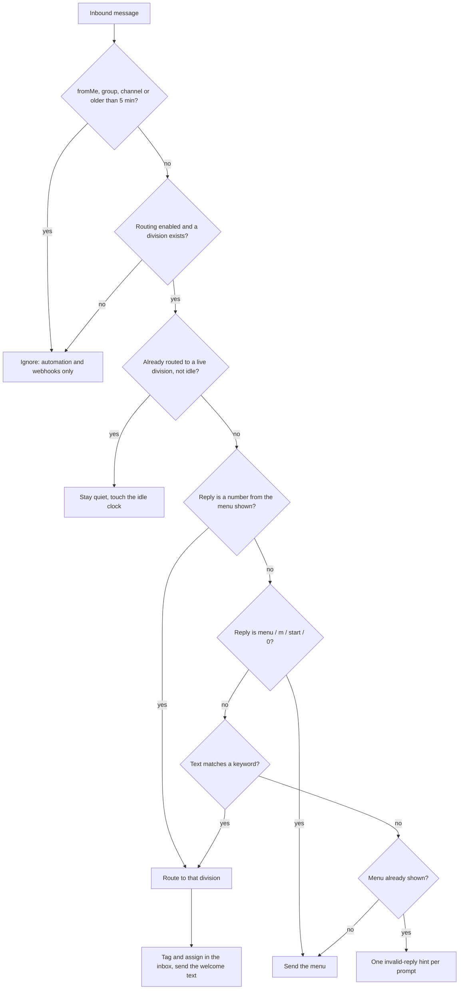

# 33. Division Routing (one number, several teams)

A single WhatsApp number can serve several divisions — "CS SMP Putra", "CS SMA Putri", "Keuangan" —
without asking customers to save a second contact. A customer writes to the shared number, picks a
team from a numbered menu (or types a keyword), and the conversation is handed to that team's CS
inside the dashboard. The customer keeps talking to the same number the whole time.

This document describes how the router decides, what it stores, and how to operate it. The routes
are in [06 — API Specification](./06-api-specification.md#6422-division-routing-one-number-several-teams);
the page is in [17 — Dashboard Design](./17-dashboard-design.md#division-routing).

---

## 33.1 The problem it solves

Without routing, every message to the shared number lands in one undifferentiated inbox. Someone
has to read it, decide which team it belongs to, and forward it by hand — which is exactly the
latency and the mistakes the shared number was supposed to avoid.

Division routing makes that decision automatic, at the moment the message arrives, and leaves a
record of it on the conversation:

| Before                                      | With division routing                                                |
| ------------------------------------------- | -------------------------------------------------------------------- |
| One inbox, everyone reads everything        | One inbox, filtered and tagged by division                           |
| A human forwards the chat to the right team | The chat is assigned to that team's least-busy CS                    |
| The decision lives in someone's head        | `divisionId` / `divisionName` on the conversation row                |
| The customer may be asked twice             | The menu is shown once per conversation, re-armed on resolve or idle |

**What "forward" means here.** The conversation is not bridged to another WhatsApp account. It is
tagged with the division and assigned to a CS, who answers from the dashboard through the same
central number. The customer sees one number and one continuous thread.

---

## 33.2 What happens to an inbound message

The router runs inside the projector's dispatch stage, after the `UNIQUE(sessionId, waMessageId)`
insert has accepted the message — so an engine re-fire never shows a second menu. It runs **before**
the automation rules and returns "handled" only when it actually sent something; a message it did
not handle (a routed chat with nothing to say, a group, a status post) still reaches automation.



Guards, all silent:

- `fromMe` messages, groups, channels, broadcast lists and status posts are never answered.
- A message older than **300 s** (a backlog replayed on reconnect) is not answered.
- Routing `enabled: false`, or a session with no divisions, leaves the message entirely to
  automation.
- Every error is swallowed and logged: a dead database or a refused send must never break the
  receive path.

---

## 33.3 The menu

The menu is **plain numbered text**, not an interactive list: the gateway has no interactive
send anywhere, and a text menu works on every WhatsApp client and every engine.

```
Welcome! Please choose the team you need:

1. SMP Putra (1)
2. SMA Putri

Reply with a number. Send "menu" at any time to see this list again.
```

- The header is `menuHeader` from the session's settings; empty uses the built-in text above.
- Items are `1. <menuLabel>` — the label defaults to the division name.
- Order is `sortOrder`, then `name`. That is the same order the dashboard lists.
- A session may hold at most **20** divisions; inactive ones are left out.
- The footer is fixed.
- The customer's numeric reply is resolved against **the list they were actually shown**
  (`menuDivisionIds` on the chat state), so a division added after the menu was sent cannot shift
  the numbering under them.
- `menu`, `m`, `start` and `0` re-send the menu, at most once every **3 s**.

---

## 33.4 Keywords

A customer who already knows where they are going should not have to read a menu.

- Matching is done on a normalised copy of the message: Unicode NFKC, lowercased, punctuation
  turned into spaces, whitespace collapsed. `"SMP-Putra!"` and `"smp putra"` are the same input.
- A keyword matches only as a **whole token sequence**: `smp` matches "saya mau smp", not "smpah".
- The **longest** matching keyword wins, so a division with `smp putra` beats one with `smp`.
- A tie is broken by menu order, then name.
- A keyword made only of digits is refused (`400` on write): it would collide with the menu
  numbering.

The same normalisation applies to the menu triggers, so `"MENU"` and `" menu "` both work.

---

## 33.5 When the menu comes back

The menu is shown **once per conversation**. It is re-armed in three cases:

1. The conversation is **resolved** in the inbox. The next message shows the menu again.
2. **`idleHours` of customer silence** — default 24, configurable 0-720, `0` disables the
   re-prompt. The clock is the customer's last message, or the routing time if they have not
   written since.
3. The routed division was **deleted or deactivated**, so the tag no longer points anywhere.

A wrong reply does not re-arm it: the customer gets the `invalidReply` text **once per prompt** (a
second wrong text in the same prompt is ignored, so a confused customer is not spammed), and the
menu stays open.

The double-menu race is closed in the database, not in memory: the first message claims the prompt
with a conditional `UPDATE … WHERE promptedAt IS NULL OR promptedAt <= rearmBefore`, and only the
caller whose update reports one affected row sends. If the send fails, the claim is released so the
next message retries and automation can answer this one. Two messages arriving together therefore
produce one menu, on one node or across several.

---

## 33.6 Assignment

Routing picks the **least busy CS of the division**: one grouped count over the division's members'
open conversations (`status != 'resolved'`), lowest count wins, ties go to the order the CS joined
the division.

- If the conversation is already assigned to someone **in that division**, the assignee is kept.
- If the conversation is assigned to someone **outside** it, the assignment moves.
- If no member is an active key, the conversation is tagged but left unassigned — the inbox still
  shows which team it belongs to, and an operator can pick up.

Membership is a snapshot of API keys: `division_agents` stores `apiKeyId` and the agent's name at
the time it was added, with no foreign key to the main connection's `api_keys`. Deactivating a key
therefore does not silently delete the membership; the assignment step simply skips it.

---

## 33.7 What lands in the inbox

Routing writes `divisionId` and `divisionName` onto the `inbox_conversations` row. That tag is the
system of record for "which team owns this chat":

- the Inbox page filters by it (`?division=<id>` or `?division=unassigned`), and shows a chip on
  each row;
- an operator can re-tag a chat by hand (`PATCH …/inbox/conversations/:chatId` with `divisionId`),
  including a chat that never saw the menu;
- deleting a division clears the tag but **keeps the assignee** — the conversation does not
  silently fall back to another team;
- resolving a conversation re-arms the menu (see §33.5).

The tag is denormalised on purpose: the inbox is the system of record, the filter must run before
pagination, and a join would make the filter a second source of truth.

---

## 33.8 Configuration

All routes sit under `/api/sessions/:sessionId/divisions`. Reads require `VIEWER`, every write
requires `ADMIN`. They are session configuration, not chat data, so a key restricted with
`allowedChats` is refused by the default-deny rule.

| Route                           | Purpose                                              |
| ------------------------------- | ---------------------------------------------------- |
| `GET    /divisions`             | List in menu order, with keywords and CS             |
| `POST   /divisions`             | Create (name unique per session)                     |
| `PATCH  /divisions/:divisionId` | Update, including the CS set                         |
| `DELETE /divisions/:divisionId` | Delete; routed chats keep their CS                   |
| `GET    /divisions/settings`    | Routing settings, with defaults                      |
| `PATCH  /divisions/settings`    | `enabled`, `menuHeader`, `invalidReply`, `idleHours` |

```bash
curl -X POST "$BASE/api/sessions/$SESSION/divisions" \
  -H "X-API-Key: $API_KEY" -H 'Content-Type: application/json' \
  -d '{
    "name": "SMP Putra",
    "menuLabel": "SMP Putra (1)",
    "keywords": ["smp", "smp putra"],
    "sortOrder": 1,
    "agentKeyIds": ["<api-key-uuid>", "<api-key-uuid>"]
  }'
```

Defaults when settings were never saved: `enabled: true`, `menuHeader: null`, `invalidReply: null`,
`idleHours: 24`.

---

## 33.9 Data and operations

- **Tables:** `divisions`, `division_agents`, `division_settings`, `division_chat_states`
  ([05 — Database Design](./05-database-design.md)). `divisions`, `division_settings` and
  `division_chat_states` cascade from `sessions`; `division_agents` cascades from its division.
- **Backups:** all four tables are exported and restored by
  `GET /api/infra/export-data` / `POST /api/infra/import-data`, and `division_agents` is cleared
  before the sessions delete on a restore.
- **Audit:** `DIVISION_CREATED`, `DIVISION_UPDATED`, `DIVISION_DELETED`,
  `DIVISION_SETTINGS_UPDATED`, `DIVISION_ROUTED` (with the chosen division and assignee) and
  `INBOX_CONVERSATION_DIVISION_CHANGED` (a manual re-tag).
- **Caching:** the router reads a per-session routing context cached for 15 s; every write
  invalidates it, so a menu edit shows up on the next message rather than after a restart.

### Troubleshooting

| Symptom                                    | Likely cause                                                                  |
| ------------------------------------------ | ----------------------------------------------------------------------------- |
| No menu at all                             | Routing disabled, no active divisions, or the message is a group/status/stale |
| Menu, but the number reply does nothing    | The division was deleted after the menu was sent; send `menu` again           |
| The customer gets a menu and an auto-reply | An automation rule on the same session fired before the router existed        |
| A chat is tagged but unassigned            | No active CS key in the division — add one or assign by hand                  |
| The menu never comes back                  | `idleHours` is `0`, and the conversation has not been resolved                |
