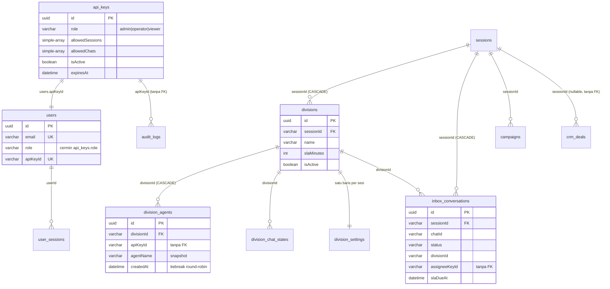
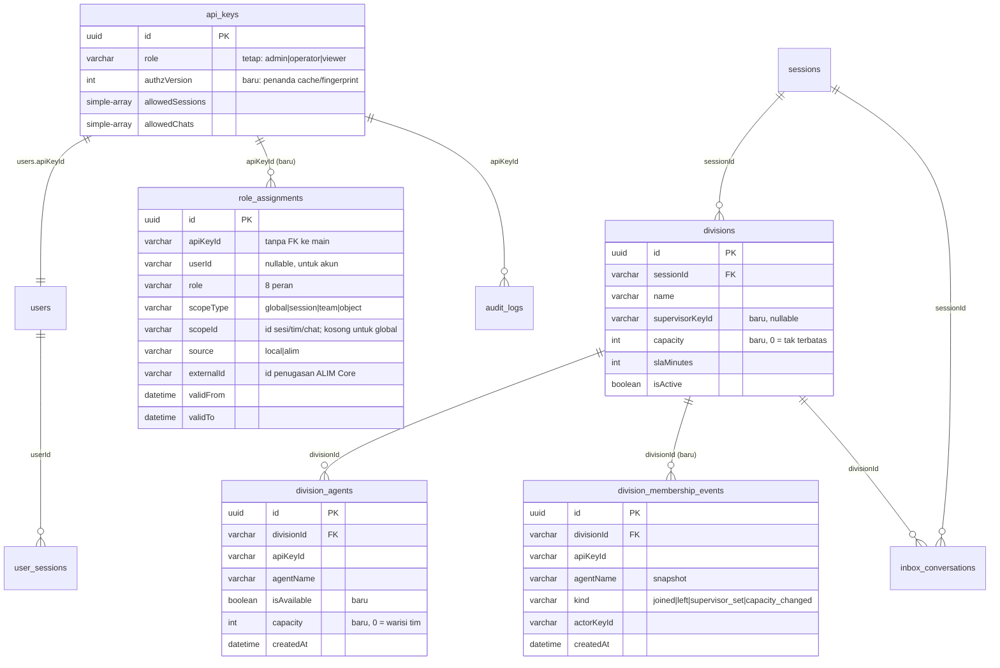

# 35. RBAC dan Tim (Fase 1): Audit dan Rancangan

Status: **disetujui untuk implementasi Fase 1a, 2026-11-21**. Sebelas keputusan final §35.9.2
diterima seluruhnya, termasuk penghapusan tahap 1d. Persetujuan hanya mencakup Fase 1a
(`role_assignments`, backfill + `rbac:verify`, `authzVersion`, `PermissionService`, jembatan
`hasPermission`, `@RequirePermission` + guard, `permissions` di `/auth/validate`, rute
`/auth/assignments`, dan penyesuaian `POST /auth/users`). Fase 1b dan 1c **belum** disetujui dan
tidak boleh dimulai sebelum 1a lolos verifikasi. Setiap klaim di bawah diperiksa langsung ke
repository pada commit `d9c5ec866`, bukan diambil dari PRD.

Revisi 2 menerapkan sebelas keputusan pemilik sistem: scope `unit` ditunda, akun baru tanpa akses
global implisit, jembatan dibatasi untuk penugasan ter-scope, key mesin memakai jalur lama sampai
diberi penugasan, agen tidak memindahkan lintas tim, otorisasi kumulatif, invalidasi segera lewat
`authzVersion`, `validTo` mengikat cache, backfill idempotent dengan gerbang verifikasi, diff
keanggotaan transaksional, dan migrasi aditif dengan rollback tanpa penghapusan skema.

Rancangan ini mengikuti keputusan yang mengikat di [34 — ALIM Connect Audit](./34-alim-connect-audit.md):
stack tetap, otorisasi yang ada diperluas (bukan dibangun ulang), `divisions` tidak diganti, dan
tidak ada refactor besar. Fase 1 hanya menambah: penugasan peran, evaluasi permission, dan medan tim
pada `divisions`.

---

## 35.1 Audit Kondisi Aktual

### 35.1.1 Angka dasar

| Aspek                 | Nilai                                                                  | Sumber                                           |
| --------------------- | ---------------------------------------------------------------------- | ------------------------------------------------ |
| Modul                 | 35                                                                     | `src/modules/*/`                                 |
| Controller            | 38                                                                     | `src/**/*.controller.ts`                         |
| Entitas               | 33                                                                     | `src/**/*.entity.ts`                             |
| Operasi API           | 249 operasi pada 195 path                                              | `openapi.json`                                   |
| Aksi audit            | 76 nilai enum                                                          | `src/modules/audit/entities/audit-log.entity.ts` |
| `@RequireRole`        | 193 pemakaian (56 ADMIN, 119 OPERATOR, 16 VIEWER, sisanya multi-baris) | `grep -rho`                                      |
| `@RequireUnscopedKey` | 54                                                                     | idem                                             |
| `@ChatScoped`         | 98                                                                     | idem                                             |
| `@SessionScoped`      | 17                                                                     | idem                                             |
| `@Public`             | 10                                                                     | idem                                             |

### 35.1.2 Identitas: `api_keys` adalah aktor sebenarnya

Seluruh sistem berbicara dalam **API key**, bukan user. `users` hanya memberi satu akun dashboard
yang memiliki tepat satu baris `api_keys` (`users.apiKeyId`), dan login password menukar sesi
menjadi key itu (`api-key.guard.ts:110-112`, `resolveSession`).

| Tabel           | Koneksi | Kolom yang menentukan akses                                                      |
| --------------- | ------- | -------------------------------------------------------------------------------- |
| `api_keys`      | `main`  | `role`, `allowedIps`, `allowedSessions`, `allowedChats`, `isActive`, `expiresAt` |
| `users`         | `main`  | `email`, `passwordHash`, `role` (cermin `api_keys.role`), `isActive`, `apiKeyId` |
| `user_sessions` | `main`  | `userId`, `tokenHash`, `expiresAt`, `revokedAt`                                  |
| `audit_logs`    | `main`  | `apiKeyId`, `ipAddress`, aksi                                                    |

`users.role` dan `api_keys.role` dijaga sinkron oleh `UsersService` (`users.service.ts:130-149`),
dan aturan "admin terakhir" membaca `api_keys.role` (`users.service.ts:219`). Artinya `role` saat ini
adalah **satu nilai, satu tabel, satu hierarki**.

### 35.1.3 Otorisasi: tiga lapis yang sudah berjalan

1. **Peran** — `@RequireRole(ApiKeyRole.X)` menaruh metadata; `ApiKeyGuard` membacanya dan memanggil
   `AuthService.hasPermission` (`api-key.guard.ts:126-128`), yang memakai hierarki angka
   `viewer=1 < operator=2 < admin=3` (`auth.service.ts:681-689`). Tidak ada daftar permission; tidak
   ada konsep "boleh aksi ini pada objek itu".
2. **Fence sesi** — `allowedSessions` (simple-array) diperiksa terhadap `:sessionId` (atau `:id` pada
   controller `@SessionScoped`), dan `@RequireUnscopedKey` menolak key bersesi pada rute yang tidak
   punya dimensi sesi (`api-key.guard.ts:95-104`, `146-156`).
3. **Fence chat** — `allowedChats` adalah allowlist dengan semantik _default deny_: key yang punya
   daftar hanya boleh mencapai handler bertanda `@ChatScoped('fenced'|'filtered'|'agnostic')`, dan
   hanya untuk chat di dalam daftar (`api-key.guard.ts:130-144`, `chat-scope.service.ts`).

Ketiganya **fail-open untuk key tanpa scope**: `allowedSessions` kosong berarti semua sesi,
`allowedChats` kosong berarti semua chat. Ini penting untuk kompatibilitas nanti.

### 35.1.4 Yang belum ada

- Tidak ada tabel penugasan peran. Satu akun = satu peran.
- Tidak ada permission granular; tidak ada cara memberi "boleh menilai kualitas" tanpa memberi
  `operator` penuh (yang boleh mengirim pesan dan menghapus chat).
- Tidak ada scope peran: `allowedSessions`/`allowedChats` membatasi **kredensial**, bukan peran.
  Dua akun dengan peran sama tidak bisa dibedakan cakupannya kecuali dengan dua key berbeda.
- Tidak ada konsep unit. `sessions` tidak punya pemilik, unit, atau organisasi (`session.entity.ts`
  hanya `id`, `name`, `status`, `phone`, `config`, proxy, timestamp).
- Tidak ada kapasitas, ketersediaan, supervisor, atau histori keanggotaan tim.
- Dashboard memakai peran klien (`admin`/`operator`/`viewer`) dari `sessionStorage` untuk
  menyembunyikan menu (`RoleProvider.tsx:79-82`, `App.tsx:177-188`). Itu kosmetik; batas sebenarnya
  tetap server.

### 35.1.5 Division hari ini

Empat tabel di koneksi `data`: `divisions`, `division_agents`, `division_settings`,
`division_chat_states`. `divisions` sudah membawa `slaMinutes` dan `isActive`; `division_agents`
menyimpan `apiKeyId` (tanpa FK ke `main`) dan snapshot `agentName`, dan `createdAt`-nya dipakai
sebagai tiebreak round-robin.

Tiga temuan yang membatasi rancangan:

1. **`writeAgents` menghapus lalu menulis ulang seluruh anggota** (`division.service.ts:392-395`).
   Setiap penyimpanan mereset `createdAt` anggota yang tidak berubah, sehingga tiebreak "anggota
   terlama" hilang dan histori tidak mungkin direkonstruksi dari tabel ini.
2. **Assignment tidak sadar kapasitas**: `pickLeastBusy` hanya memilih key aktif dengan jumlah
   percakapan terbuka paling sedikit (`inbox.service.ts:361-375`).
3. **`division_agents` tidak punya status ketersediaan**; agen yang sedang cuti tetap menerima
   percakapan.

### 35.1.6 Konsumen division

`divisionId` dipakai oleh inbox (assignment, filter, laporan), SLA (`inbox_sla.service.ts`), dan
backup/import (`export-tables.ts`). Tidak ada modul lain yang menyentuhnya. Ini membuat evolusi
`divisions` menjadi tim berisiko rendah **selama nama tabel dan API dipertahankan**.

### 35.1.7 Modul yang akan terpengaruh

| Modul          | Ketergantungan sekarang                    | Dampak Fase 1                           |
| -------------- | ------------------------------------------ | --------------------------------------- |
| Inbox          | `@RequireRole` + chat fence; filter divisi | Permission `inbox.*` + filter scope tim |
| SLA/Reports    | membaca `divisionId`, `assigneeKeyId`      | tidak berubah bentuk; ikut scope        |
| Contact/CRM    | per sesi / global + `@RequireUnscopedKey`  | hanya pemetaan permission               |
| Campaign       | per sesi, OPERATOR                         | `campaign.*` untuk Campaign Manager     |
| Division       | ADMIN untuk tulis, VIEWER untuk baca       | `team.*`, supervisor, kapasitas         |
| Users/API keys | ADMIN, `@RequireUnscopedKey`               | `user.*`, `apikey.*`, `role.assign`     |
| Dashboard      | peran klien                                | permission dari `/auth/validate`        |

### 35.1.8 Temuan teknis yang harus dihormati implementasi

- **Guard berurutan**: `ProxyAwareThrottlerGuard` lalu `ApiKeyGuard` (`auth.module.ts:41-47`). Guard
  permission baru harus didaftarkan **setelah** `ApiKeyGuard`, karena ia membaca `request.apiKey`.
- **Fingerprint otorisasi** (`api-key-authorization.ts`) menentukan kapan WebSocket diputus. Isinya
  peran + scope + expiry, dan sengaja **tidak** memuat `updatedAt`. Perubahan penugasan karena itu
  tidak akan terlihat oleh fingerprint hari ini — perlu komponen versi otorisasi.
- **`main` punya rantai migrasi sendiri** (`migrations-main/`) dan pemeriksaan kolom saat boot
  (`main-connection.ts:46-57`, `createMainDataSource`). Entitas baru di `main` wajib berada di bawah
  `src/modules/auth/**` atau `src/modules/audit/**`, dan wajib punya migrasi di `migrations-main/`
  meskipun `synchronize` aktif.
- **`data` memakai glob per modul** (`data-source.ts:46-59` dan `app.module.ts`), jadi entitas baru
  di modul yang sudah terdaftar otomatis ikut; modul baru butuh dua tempat.
- **Drift gate** membandingkan multiset statement terhadap `__fixtures__/known-migration-drift.json`
  (`main` dan `data` terpisah). Migrasi yang DDL-nya cocok dengan entitas tidak menambah drift.
- **Backup** menyalin seluruh `main.sqlite`; registry export/import hanya untuk tabel `data`
  (`export-tables.ts`). Tabel `main` baru tidak perlu didaftarkan ke export, tetapi tabel `data`
  baru (histori anggota) perlu.
- **Aksi audit** dijaga `audit-coverage.spec.ts`: enum baru wajib benar-benar dipakai.

---

## 35.2 ERD

### 35.2.1 Kondisi sekarang



### 35.2.2 Rancangan target

Tambahan ditandai **(baru)** dan **(kolom baru)**; tidak ada tabel atau kolom yang dihapus.



Catatan model:

- `role_assignments` berada di `main` karena menempel pada `api_keys`/`users`; `scopeId` merujuk
  entitas `data` **tanpa FK**, pola yang sudah dipakai `division_agents.apiKeyId`.
- `scopeId` **bukan NULL** melainkan `''` untuk `global`, agar unique index benar-benar menegakkan
  satu penugasan per (key, role, scope) — SQLite menganggap NULL selalu berbeda.
- `units` tidak ada di target. Alasannya di §35.9.

---

## 35.3 Katalog Permission dan Matriks Peran

Penamaan `resource.action`. Tanda: **✓** = boleh (tetap dibatasi scope penugasan), **—** = tidak,
**S** = hanya dalam scope yang diberikan (unit/tim/sesi/objek).

### 35.3.1 Identitas dan konfigurasi

| Permission       | system_admin | connect_admin | supervisor | team_leader | agent | quality_evaluator | campaign_manager | analyst |
| ---------------- | :----------: | :-----------: | :--------: | :---------: | :---: | :---------------: | :--------------: | :-----: |
| `user.read`      |      ✓       |       ✓       |     S      |      —      |   —   |         —         |        —         |    —    |
| `user.manage`    |      ✓       |       ✓       |     —      |      —      |   —   |         —         |        —         |    —    |
| `apikey.read`    |      ✓       |       ✓       |     —      |      —      |   —   |         —         |        —         |    —    |
| `apikey.manage`  |      ✓       |       ✓       |     —      |      —      |   —   |         —         |        —         |    —    |
| `role.read`      |      ✓       |       ✓       |     S      |      —      |   —   |         —         |        —         |    —    |
| `role.assign`    |      ✓       |       ✓       |     —      |      —      |   —   |         —         |        —         |    —    |
| `settings.write` |      ✓       |       ✓       |     —      |      —      |   —   |         —         |        —         |    —    |
| `infra.read`     |      ✓       |       ✓       |     —      |      —      |   —   |         —         |        —         |    —    |
| `infra.write`    |      ✓       |       —       |     —      |      —      |   —   |         —         |        —         |    —    |
| `plugin.manage`  |      ✓       |       —       |     —      |      —      |   —   |         —         |        —         |    —    |
| `audit.read`     |      ✓       |       ✓       |     S      |      —      |   —   |         —         |        —         |    S    |

### 35.3.2 Integrasi dan webhook

| Permission          | system_admin | connect_admin | supervisor | team_leader | agent | quality_evaluator | campaign_manager | analyst |
| ------------------- | :----------: | :-----------: | :--------: | :---------: | :---: | :---------------: | :--------------: | :-----: |
| `integration.read`  |      ✓       |       ✓       |     —      |      —      |   —   |         —         |        —         |    —    |
| `integration.write` |      ✓       |       ✓       |     —      |      —      |   —   |         —         |        —         |    —    |
| `webhook.read`      |      ✓       |       ✓       |     S      |      —      |   —   |         —         |        —         |    —    |
| `webhook.write`     |      ✓       |       ✓       |     —      |      —      |   —   |         —         |        —         |    —    |

### 35.3.3 Sesi dan kanal

| Permission            | system_admin | connect_admin | supervisor | team_leader | agent | quality_evaluator | campaign_manager | analyst |
| --------------------- | :----------: | :-----------: | :--------: | :---------: | :---: | :---------------: | :--------------: | :-----: |
| `session.read`        |      ✓       |       ✓       |     S      |      S      |   S   |         S         |        S         |    S    |
| `session.write`       |      ✓       |       ✓       |     —      |      —      |   —   |         —         |        —         |    —    |
| `session.control`     |      ✓       |       ✓       |     —      |      —      |   —   |         —         |        —         |    —    |
| `session.delete`      |      ✓       |       —       |     —      |      —      |   —   |         —         |        —         |    —    |
| `session.proxy.write` |      ✓       |       —       |     —      |      —      |   —   |         —         |        —         |    —    |

### 35.3.4 Pesan, kontak, dan chat

| Permission       | system_admin | connect_admin | supervisor | team_leader | agent | quality_evaluator | campaign_manager | analyst |
| ---------------- | :----------: | :-----------: | :--------: | :---------: | :---: | :---------------: | :--------------: | :-----: |
| `message.read`   |      ✓       |       ✓       |     S      |      S      |   S   |         S         |        S         |    S    |
| `message.send`   |      ✓       |       ✓       |     S      |      S      |   S   |         —         |        —         |    —    |
| `message.delete` |      ✓       |       ✓       |     S      |      —      |   —   |         —         |        —         |    —    |
| `message.bulk`   |      ✓       |       ✓       |     —      |      —      |   —   |         —         |        —         |    —    |
| `chat.read`      |      ✓       |       ✓       |     S      |      S      |   S   |         S         |        S         |    S    |
| `chat.write`     |      ✓       |       ✓       |     S      |      S      |   S   |         —         |        —         |    —    |
| `contact.read`   |      ✓       |       ✓       |     S      |      S      |   S   |         S         |        S         |    S    |
| `contact.write`  |      ✓       |       ✓       |     S      |      S      |   S   |         —         |        —         |    —    |
| `group.read`     |      ✓       |       ✓       |     S      |      S      |   S   |         —         |        —         |    S    |
| `group.write`    |      ✓       |       ✓       |     —      |      —      |   —   |         —         |        —         |    —    |
| `label.read`     |      ✓       |       ✓       |     S      |      S      |   S   |         S         |        S         |    S    |
| `label.write`    |      ✓       |       ✓       |     S      |      S      |   S   |         —         |        —         |    —    |
| `profile.read`   |      ✓       |       ✓       |     S      |      S      |   S   |         —         |        —         |    S    |
| `profile.write`  |      ✓       |       ✓       |     —      |      —      |   —   |         —         |        —         |    —    |
| `status.read`    |      ✓       |       ✓       |     S      |      S      |   S   |         —         |        S         |    S    |
| `status.write`   |      ✓       |       ✓       |     —      |      —      |   —   |         —         |        —         |    —    |

### 35.3.5 Inbox dan tim

| Permission                 | system_admin | connect_admin | supervisor | team_leader | agent | quality_evaluator | campaign_manager | analyst |
| -------------------------- | :----------: | :-----------: | :--------: | :---------: | :---: | :---------------: | :--------------: | :-----: |
| `inbox.read`               |      ✓       |       ✓       |     S      |      S      |   S   |         S         |        S         |    S    |
| `inbox.assign`             |      ✓       |       ✓       |     S      |      S      |   S   |         —         |        —         |    —    |
| `inbox.status`             |      ✓       |       ✓       |     S      |      S      |   S   |         —         |        —         |    —    |
| `inbox.note`               |      ✓       |       ✓       |     S      |      S      |   S   |         S         |        —         |    —    |
| `inbox.note.delete`        |      ✓       |       ✓       |     S      |      S      |   —   |         —         |        —         |    —    |
| `inbox.report.read`        |      ✓       |       ✓       |     S      |      S      |   —   |         S         |        —         |    S    |
| `team.read`                |      ✓       |       ✓       |     S      |      S      |   S   |         S         |        S         |    S    |
| `team.manage`              |      ✓       |       ✓       |     —      |      —      |   —   |         —         |        —         |    —    |
| `team.member.manage`       |      ✓       |       ✓       |     S      |      S      |   —   |         —         |        —         |    —    |
| `team.availability.manage` |      ✓       |       ✓       |     S      |      S      |   —   |         —         |        —         |    —    |

`inbox.assign` untuk `agent` hanya berlaku pada dirinya sendiri; aturan itu ditegakkan di service
(bukan di matriks), karena "assignee = diri sendiri" adalah syarat objek, bukan permission lain.

### 35.3.6 CRM, kampanye, template, otomasi

| Permission         | system_admin | connect_admin | supervisor | team_leader | agent | quality_evaluator | campaign_manager | analyst |
| ------------------ | :----------: | :-----------: | :--------: | :---------: | :---: | :---------------: | :--------------: | :-----: |
| `crm.read`         |      ✓       |       ✓       |     S      |      S      |   S   |         —         |        S         |    S    |
| `crm.write`        |      ✓       |       ✓       |     S      |      S      |   S   |         —         |        —         |    —    |
| `crm.delete`       |      ✓       |       ✓       |     —      |      —      |   —   |         —         |        —         |    —    |
| `crm.stage.write`  |      ✓       |       ✓       |     —      |      —      |   —   |         —         |        —         |    —    |
| `campaign.read`    |      ✓       |       ✓       |     S      |      S      |   —   |         —         |        S         |    S    |
| `campaign.write`   |      ✓       |       ✓       |     —      |      —      |   —   |         —         |        S         |    —    |
| `campaign.run`     |      ✓       |       ✓       |     —      |      —      |   —   |         —         |        S         |    —    |
| `campaign.delete`  |      ✓       |       ✓       |     —      |      —      |   —   |         —         |        —         |    —    |
| `template.read`    |      ✓       |       ✓       |     S      |      S      |   S   |         —         |        S         |    S    |
| `template.write`   |      ✓       |       ✓       |     —      |      —      |   —   |         —         |        S         |    —    |
| `automation.read`  |      ✓       |       ✓       |     S      |      S      |   —   |         —         |        —         |    —    |
| `automation.write` |      ✓       |       ✓       |     —      |      —      |   —   |         —         |        —         |    —    |

### 35.3.7 Analitik

| Permission   | system_admin | connect_admin | supervisor | team_leader | agent | quality_evaluator | campaign_manager | analyst |
| ------------ | :----------: | :-----------: | :--------: | :---------: | :---: | :---------------: | :--------------: | :-----: |
| `stats.read` |      ✓       |       ✓       |     S      |      S      |   —   |         S         |        S         |    S    |

### 35.3.8 Dicadangkan untuk fase berikutnya

`ticket.read`, `ticket.write` (Fase 2), `quality.evaluate` (Fase 6), `report.export` (Fase 6).
Tidak ada rute yang memakainya di Fase 1; katalog menandainya `reserved` agar gerbang cakupan tidak
menuntutnya dipakai.

---

## 35.4 Pemetaan Peran Lama ke Peran Baru

`ApiKeyRole` **tidak diperluas**. Ia tetap tiga nilai dan tetap disimpan di `api_keys.role`, karena
(a) DTO `CreateUserDto`/`UpdateUserDto` memvalidasinya, (b) aturan "admin terakhir" membacanya, dan
(c) hierarki `hasPermission` akan memperlakukan nilai tak dikenal sebagai level 0 — menolak semua
rute secara diam-diam.

Delapan peran hidup di `role_assignments.role` saja:

| Peran baru            | Nilai               | Padanan lama | Level jembatan `@RequireRole` |
| --------------------- | ------------------- | ------------ | ----------------------------- |
| System Administrator  | `system_admin`      | `admin`      | ADMIN                         |
| Connect Administrator | `connect_admin`     | `admin`      | ADMIN                         |
| Supervisor            | `supervisor`        | `operator`   | OPERATOR                      |
| Team Leader           | `team_leader`       | `operator`   | OPERATOR                      |
| Agent/Petugas         | `agent`             | `operator`   | OPERATOR                      |
| Quality Evaluator     | `quality_evaluator` | `viewer`     | VIEWER                        |
| Campaign Manager      | `campaign_manager`  | `operator`   | OPERATOR                      |
| Analyst/Management    | `analyst`           | `viewer`     | VIEWER                        |

Backfill (satu kali, di migrasi, **hanya untuk key yang sudah ada saat migrasi berjalan**):

| `api_keys.role` | Baris `role_assignments` yang dibuat                     |
| --------------- | -------------------------------------------------------- |
| `admin`         | `system_admin` (global) **dan** `connect_admin` (global) |
| `operator`      | `agent` (global)                                         |
| `viewer`        | `analyst` (global)                                       |

Scope `global` dipilih supaya **tidak ada yang kehilangan akses**: cakupan hari ini ditentukan
`allowedSessions`/`allowedChats`, dan keduanya tetap berlaku sebagai fence kredensial di atas
penugasan. Backfill tidak pernah menjadi default untuk kredensial baru (lihat di bawah).

### 35.4.1 Kredensial baru tidak mendapat akses global secara otomatis

Keputusan pemilik sistem: **hanya backfill** yang boleh memberi scope global. Setelah Fase 1,
penugasan selalu merupakan tindakan administrator yang sadar.

| Jalur                             | Perilaku                                                                                                                                                                                                              |
| --------------------------------- | --------------------------------------------------------------------------------------------------------------------------------------------------------------------------------------------------------------------- |
| `POST /auth/users` (akun manusia) | `assignments` **wajib** (minimal satu). Tanpa itu `400`. `role` lama tetap diterima dan hanya dipakai untuk menurunkan `api_keys.role` (aturan admin terakhir dan tampilan lama).                                     |
| `POST /auth/api-keys` (key mesin) | `role` tetap wajib seperti sekarang dan key langsung berfungsi lewat jalur lama (lihat §35.4.2). `assignments` opsional; bila dikirim, key menjadi ter-scope.                                                         |
| Dashboard                         | Form akun baru mewajibkan memilih peran **dan** scope (sesi/tim/objek); pilihan `global` hanya muncul bagi pemberi yang memegang `system_admin` global, sesuai aturan "tidak ada eskalasi lewat pemberian" (§35.5.6). |

Akun tanpa penugasan tetap bisa masuk dan hanya mencapai rute swalayan: `/auth/validate`,
`/auth/session/me`, `/auth/session/logout`, ganti password sendiri. Sisanya `403`.

### 35.4.2 Key mesin: jalur lama, bukan role manusia

Key mesin tidak pernah otomatis mendapat peran manusia. Selama key itu **tidak punya penugasan**,
otorisasinya tetap persis seperti hari ini: level diturunkan dari `api_keys.role`
(`admin`/`operator`/`viewer`) yang memang dinyatakan pemanggil saat membuat key. Ini jalur
kompatibilitas, bukan assignment.

Begitu sebuah key (manusia atau mesin) **punya minimal satu penugasan**, `api_keys.role` berhenti
memberi permission; yang berlaku hanya penugasan itu. Dengan demikian menambahkan penugasan `team`
ke key mesin yang tadinya `operator` mempersempitnya, tidak pernah memperluasnya.

### 35.4.3 Jembatan `@RequireRole`

`AuthService.hasPermission` menghitung level dari penugasan aktif (ambil tertinggi), dan hanya
memakai `api_keys.role` bila key tidak punya penugasan sama sekali:

| Keadaan key                                               | Level jembatan                          |
| --------------------------------------------------------- | --------------------------------------- |
| Punya penugasan `system_admin`/`connect_admin` **global** | ADMIN                                   |
| Punya penugasan, tidak ada yang global                    | **maksimal OPERATOR**                   |
| Tidak punya penugasan                                     | level dari `api_keys.role` (jalur lama) |

Batas OPERATOR untuk penugasan ter-scope adalah pengaman yang diminta: sebuah assignment `team`
tidak boleh membuka rute ADMIN (mis. `DELETE /sessions/:id`, `POST /sessions/:id/divisions`,
`/auth/users`) lewat jembatan. Untuk key hasil backfill hasilnya identik dengan hari ini — diuji
sebagai kesetaraan penuh (§35.8.2).

**Celah transisi yang diakui.** Rute yang masih `@RequireRole` tidak punya dimensi tim, jadi agen
ber-scope tim masih bisa mencapai rute OPERATOR tingkat sesi (mis. `POST .../messages` ke chat mana
pun di sesi itu, `contact.*`, `group.*`). Yang sudah tertutup sejak 1c: seluruh permukaan inbox,
laporan, tim, users, dan API key. Rute tersisa dicatat satu per satu di
`permission-coverage.spec.ts` beserta alasannya, dan daftar itu **hanya boleh menyusut**.

### 35.4.4 Aturan admin terakhir

Setelah 1a, "admin terakhir" berarti **minimal satu akun aktif dengan penugasan `system_admin`
global**, bukan sekadar `api_keys.role = 'admin'`. Kolom lama tetap dibaca sebagai cadangan selama
masa transisi. Tanpa koreksi ini, akun `system_admin` ber-scope tim akan ikut dihitung sebagai admin
global dan aturan terakhir bisa lolos.

---

## 35.5 PermissionService dan `@RequirePermission`

### 35.5.1 Bentuk evaluasi

```ts
type ScopeType = 'global' | 'session' | 'team' | 'object';

interface Assignment {
  role: RoleName; // 8 nilai
  scopeType: ScopeType;
  scopeId: string; // '' untuk global
  validFrom: Date | null;
  validTo: Date | null;
}

interface EffectiveAccess {
  roles: Set<RoleName>;
  permissions: Set<Permission>;
  scope: {
    global: boolean;
    sessionIds: Set<string>; // scopeType='session'
    divisionIds: Set<string>; // scopeType='team'
    chatIds: Set<string>; // scopeType='object'
  };
}

interface ResourceRef {
  sessionId?: string;
  divisionId?: string | null;
  chatId?: string;
}
```

### 35.5.2 Algoritma

```
effective(apiKey):
  rows = role_assignments where apiKeyId = apiKey.id and now within [validFrom, validTo]
  if rows is empty: rows = [{ role: legacyRoleToNew(apiKey.role), scopeType: 'global' }]
  permissions = union(ROLE_PERMISSIONS[row.role] for row in rows)
  scope = mergeScopes(rows)          // global bila salah satu global

can(apiKey, permission, resource?):
  access = effective(apiKey)
  if permission not in access.permissions: false
  if access.scope.global: true
  if resource is undefined: true      // pemanggil wajib memfilter daftar lewat scope()
  if resource.chatId in scope.chatIds: true
  if resource.sessionId in scope.sessionIds: true
  if resource.divisionId in scope.divisionIds: true
  false
```

Dua aturan penting:

- **Fence kredensial tetap di atas permission.** `allowedSessions` dan `allowedChats` diperiksa lebih
  dulu oleh `ApiKeyGuard`; penugasan tidak bisa memperlebarnya. Sebuah `system_admin` dengan key
  bersesi satu tetap hanya bisa menyentuh sesi itu.
- **`can()` tanpa resource hanya menjawab "boleh jenis aksi ini"**. Daftar (inbox, sesi, laporan)
  difilter lewat `scope()` di service, bukan dengan memanggil `can()` per baris.

### 35.5.3 Filter daftar

```ts
interface ListScope {
  sessionIds: Set<string> | null;   // null = semua
  divisionIds: Set<string> | null;  // null = semua
  chatIds: Set<string> | null;      // null = semua
}
scope(apiKey): ListScope   // sudah diiris dengan allowedSessions/allowedChats
```

Titik pakai Fase 1:

| Pembacaan                     | Filter                                                              |
| ----------------------------- | ------------------------------------------------------------------- |
| `GET /sessions`               | `sessionIds` (sudah ada lewat `resolveSessionScope`; dipertahankan) |
| `GET .../inbox/conversations` | `divisionIds` lalu `chatIds`, sebelum paging                        |
| `GET .../inbox/summary`       | idem                                                                |
| `GET .../inbox/reports`       | `divisionIds` pada kueri laporan                                    |
| `GET /audit`                  | `sessionIds` (sudah ada)                                            |

Percakapan tanpa divisi (`divisionId = null`) **tidak terlihat** oleh penugasan `team`, tetapi tetap
terlihat oleh `session`/`global`. Ini disengaja: agen tim tidak boleh membaca antrean yang belum
dirutekan ke tim mana pun, sedangkan supervisor sesi perlu melihatnya untuk merutekan.

### 35.5.4 Cache, masa berlaku, dan invalidasi

- Evaluasi disimpan per `apiKeyId` selama **15 detik**, dengan memo per request agar satu request
  tidak membaca dua kali.
- **`validTo` membatasi cache, bukan sebaliknya.** Entri menyimpan
  `expiresAt = min(now + 15s, min(validTo) - 1ms)`; evaluasi juga memeriksa `validFrom <= now < validTo`
  setiap kali dipakai. Jadi penugasan yang berakhir tidak pernah dilayani dari cache, bahkan bila
  entri itu belum kedaluwarsa.
- Setiap penulisan `role_assignments` (tambah, ubah, cabut), `users`, atau `api_keys` memanggil
  `invalidate(apiKeyId)` **dan** menaikkan `api_keys.authzVersion` di transaksi yang sama.
- `authzVersion` masuk ke `apiKeyAuthorizationFingerprint`. Setelah commit, layanan penugasan
  memanggil `AuthService.bumpAuthorization(keyId)` yang membuang socket key itu secara sinkron
  (`authorization_changed`), jalur yang sama dengan `AuthService.update` hari ini. Sweep gateway
  (60 detik) tetap menjadi jaring pengaman untuk perubahan yang tidak lewat proses ini.
- Multi-node: TTL 15 detik dan sweep 60 detik adalah batas penyebaran antar-node; tidak ada pub/sub
  baru di Fase 1. Konsekuensi ini diterima dan dicatat.

### 35.5.5 Decorator dan guard

```ts
export const RequirePermission = (...permissions: Permission[]) => SetMetadata(PERMISSIONS_KEY, permissions);
```

- Semantik: **semua** permission yang disebut harus dimiliki (AND). Tidak ada `anyOf` di Fase 1.
- `PermissionGuard` didaftarkan sebagai `APP_GUARD` **setelah** `ApiKeyGuard` di `AuthModule`.
- Bila handler tidak membawa metadata permission, guard tidak melakukan apa pun: rute lama tetap
  dijaga `@RequireRole`.
- Bila ada metadata, guard membangun `ResourceRef` dari `params.sessionId`, `params.divisionId`,
  `params.chatId`/`groupId`/`contactId`, lalu memanggil `assert`. `403` menyebut permission yang
  kurang, bukan peran — supaya pesan tidak membocorkan struktur peran.

### 35.5.6 Rute baru (semua `@RequireUnscopedKey`, karena tidak punya dimensi sesi)

| Rute                              | Permission    | Keterangan                     |
| --------------------------------- | ------------- | ------------------------------ |
| `GET /auth/assignments?apiKeyId=` | `role.read`   | daftar penugasan satu key/akun |
| `POST /auth/assignments`          | `role.assign` | tambah penugasan               |
| `PATCH /auth/assignments/:id`     | `role.assign` | ubah masa berlaku/scope        |
| `DELETE /auth/assignments/:id`    | `role.assign` | cabut penugasan                |

Aturan yang ditegakkan server:

- `scopeType='session'` mewajibkan `scopeId` berupa id sesi yang ada.
- `scopeType='team'` mewajibkan `scopeId` berupa id divisi yang ada.
- `scopeType='object'` mewajibkan `scopeId` berupa chat id yang valid.
- `scopeType='unit'` **ditolak** `400` di Fase 1 dengan pesan yang menyebut Fase 4 (lihat §35.9).
  Rancangan bagaimana `unit` nanti diikat ke UUID unit ALIM Core — bukan tabel unit lokal — ada di
  [35a](./35a-alim-core-organization-mapping.md) §7.
- Penugasan hanya boleh menyebut `scopeId` yang dapat dijangkau pemberi: `system_admin` global boleh
  memberi scope apa pun; pemberi yang ter-scope hanya boleh memberi scope di dalam cakupannya sendiri
  (tidak ada eskalasi lewat pemberian).
- Menghapus penugasan terakhir yang memberi `system_admin` global ditolak `409`, sama seperti aturan
  admin terakhir hari ini.
- `POST /auth/users` menolak `400` bila `assignments` kosong; tidak ada penugasan global implisit.
- `POST /auth/api-keys` tetap menerima `role` tanpa `assignments` (jalur lama, §35.4.2); bila
  `assignments` dikirim, key langsung ter-scope dan `role` berhenti memberi permission.

`GET /auth/validate` dan `GET /auth/users` mendapat field tambahan (aditif):
`roles: string[]`, `permissions: string[]`, `assignments: [...]`.

---

## 35.6 Division Menjadi Tim

### 35.6.1 Medan baru (aditif)

| Tabel             | Kolom                                    | Arti                                         |
| ----------------- | ---------------------------------------- | -------------------------------------------- |
| `divisions`       | `supervisorKeyId varchar(36) NULL`       | supervisor tim; tanpa FK ke `main`           |
| `divisions`       | `capacity int NOT NULL DEFAULT 0`        | batas percakapan aktif tim; 0 = tak terbatas |
| `division_agents` | `isAvailable boolean NOT NULL DEFAULT 1` | agen menerima assignment baru                |
| `division_agents` | `capacity int NOT NULL DEFAULT 0`        | batas per agen; 0 = warisi tim               |

Nama tabel, rute, dan DTO dipertahankan. `DivisionDto` mendapat field baru; tidak ada yang dihapus.

### 35.6.2 Histori keanggotaan

Tabel baru `division_membership_events`:

| Kolom        | Isi                                                                          |
| ------------ | ---------------------------------------------------------------------------- |
| `id`         | uuid                                                                         |
| `divisionId` | FK ke `divisions` (CASCADE)                                                  |
| `apiKeyId`   | key yang bergabung/keluar                                                    |
| `agentName`  | snapshot nama saat kejadian                                                  |
| `kind`       | `joined`, `left`, `supervisor_set`, `supervisor_cleared`, `capacity_changed` |
| `actorKeyId` | siapa yang mengubah (dari `request.apiKey`)                                  |
| `detail`     | JSON kecil (mis. `{ from: 5, to: 10 }`)                                      |
| `createdAt`  | waktu kejadian                                                               |

Backfill: satu baris `joined` per baris `division_agents` yang ada, `createdAt = division_agents.createdAt`.

Perubahan yang menyertainya:

- `writeAgents` diganti **diff**, bukan hapus-tulis: anggota yang tetap mempertahankan baris dan
  `createdAt`-nya (tiebreak round-robin tidak lagi reset), yang keluar dihapus, yang masuk ditambah.
  Event ditulis hanya untuk delta.
- **Satu transaksi.** Diff anggota, penulisan event, perubahan supervisor/kapasitas, dan
  pembaruan `updatedAt` berjalan di dalam satu transaksi pada koneksi `data`
  (`dataSource.transaction`). Bila salah satu gagal, tidak ada anggota yang setengah berubah dan
  tidak ada event yatim. Cache routing (`invalidate(sessionId)`) baru dibuang **setelah** commit.
- `division_agents.createdAt` menjadi bermakna lagi sebagai "bergabung sejak"; tidak ada jalur kode
  yang menulis ulang baris anggota tanpa perubahan.

### 35.6.3 Assignment yang sadar kapasitas dan ketersediaan

`pickLeastBusy` diperluas:

1. Kandidat = anggota tim yang `isAvailable` dan key-nya `isActive`.
2. Buang kandidat yang percakapan terbukanya sudah mencapai `division_agents.capacity` (bila > 0).
3. Bila total percakapan terbuka tim sudah mencapai `divisions.capacity` (bila > 0), jangan assign:
   percakapan tetap `unassigned`, `inbox.updated` tetap dikirim, dan supervisor melihatnya di antrean.
4. Sisanya dipilih dengan aturan lama (paling sedikit, tiebreak `createdAt`).

Semua default `0`/`true`, sehingga perilaku hari ini tidak berubah sampai admin mengisi angkanya.

### 35.6.4 Yang tidak diubah

Menu, keyword, `welcomeText`, `sortOrder`, `slaMinutes`, `division_chat_states`, router, dan laporan
tetap seperti sekarang. "Tim" adalah **nama konsep**, bukan tabel baru: tidak ada `teams` paralel.

---

## 35.7 Migrasi, Kompatibilitas, dan Rollback

### 35.7.1 Migrasi `main` (SQLite saja)

| Nama                    | Isi                                                                   |
| ----------------------- | --------------------------------------------------------------------- |
| `CreateRoleAssignments` | tabel + 3 index + backfill dari `api_keys`/`users`                    |
| `AddApiKeyAuthzVersion` | `ALTER TABLE api_keys ADD COLUMN authzVersion int NOT NULL DEFAULT 0` |

Backfill **idempotent**: setiap baris ditulis dengan `INSERT OR IGNORE` terhadap unique index
`(apiKeyId, role, scopeType, scopeId)`, sehingga migrasi yang dijalankan ulang (mis. setelah boot
gagal di tengah jalan) tidak menggandakan penugasan. Tidak ada `UPDATE` yang menimpa penugasan yang
sudah ada.

Catatan lain: id backfill dibuat dengan `lower(hex(randomblob(16)))` karena SQLite tidak punya
`uuid()`; `scopeId` diisi `''`, bukan NULL.

### 35.7.2 Gerbang verifikasi sebelum aktivasi

Sebelum 1c (yang mengubah perilaku) diaktifkan, jalankan `npm run rbac:verify` — skrip **baca saja**
yang:

1. membaca setiap `api_keys` dan penugasan aktifnya;
2. menghitung `hasPermission` lama (dari `api_keys.role`) dan baru (dari penugasan);
3. menghitung `permissions` efektif untuk setiap key;
4. menolak (exit 1) bila ada key yang level lamanya ≠ level barunya, atau bila ada key tanpa
   penugasan yang bukan key mesin yang memang memakai jalur lama;
5. mencetak ringkasan: jumlah key per peran, jumlah penugasan per scope, key tanpa penugasan.

Skrip ini juga dijalankan sebagai tes migrasi terhadap fixture hasil backfill, sehingga regresi
terdeteksi tanpa database produksi.

### 35.7.3 Migrasi `data` (SQLite dan PostgreSQL)

| Nama                             | Isi                               | `down()`         |
| -------------------------------- | --------------------------------- | ---------------- |
| `AddTeamFieldsToDivisions`       | `supervisorKeyId`, `capacity`     | drop kedua kolom |
| `AddAgentAvailability`           | `isAvailable`, `capacity`         | drop kedua kolom |
| `CreateDivisionMembershipEvents` | tabel + index + backfill `joined` | drop tabel       |

Semua memakai guard `hasTable`/`hasColumn` dan cabang `isPostgres`, sesuai pola 34.6. Kolom tanggal
memakai `dateColumnType()`/`text` agar tidak menambah drift.

### 35.7.4 Kompatibilitas

- **Data**: tidak ada kolom/tabel lama yang dihapus. `api_keys.role` dan `users.role` tetap.
- **API**: hanya penambahan field dan rute. Satu pengecualian yang disengaja: `POST /auth/users`
  mewajibkan `assignments` (§35.4.1) — pemanggil lama yang hanya mengirim `role` menerima `400`
  dengan pesan yang menyebut field yang hilang, bukan akun tanpa akses.
- **Perilaku**: backfill global membuat hasil otorisasi identik untuk key yang sudah ada. Kredensial
  baru tidak mendapat akses global (§35.4.1); key mesin tanpa penugasan tetap memakai jalur lama
  (§35.4.2).
- **Otorisasi kumulatif**: `@RequireRole`, fence sesi, fence chat, dan permission dievaluasi
  seluruhnya; penugasan tidak pernah melewati fence kredensial.
- **Dashboard**: peran klien tetap ada sebagai cadangan; gating beralih ke `permissions` dari
  `/auth/validate` setelah field itu tersedia.
- **Backup**: `main.sqlite` tersalin utuh; `division_membership_events` ditambahkan ke
  `EXPORT_TABLES` + `TABLE_IMPORTERS` agar ikut export/import.
- **SDK**: tidak berubah; field baru hanya muncul di respons yang sudah ada.

### 35.7.5 Rollback

1. **Rollback aplikasi tidak menghapus apa pun.** Kembalikan rilis sebelumnya; kode lama tidak
   membaca `role_assignments`, `authzVersion`, kolom tim, atau tabel histori. Skema baru boleh tetap
   ada — kolom bertipe `NULL`/default dan tabel yang tidak dibaca tidak mengganggu rilis lama.
2. `down()` tetap disediakan untuk pemulihan bencana, bukan syarat rollback. Urutannya: `data`
   (histori → ketersediaan → medan tim), lalu `main` (`authzVersion` → `role_assignments`).
   `role_assignments` aman dihapus karena `api_keys.role` masih sumber kebenaran.
3. Sebelum `down()` dijalankan, wajib backup (`scripts/backup.sh`): tabel histori tidak bisa
   direkonstruksi setelah dihapus.
4. Migrasi tidak pernah menyentuh data lama selain menambah kolom/tabel; tidak ada `DROP` atau
   `UPDATE` destruktif di `up()`.

---

## 35.8 Risiko dan Rencana Tes

### 35.8.1 Risiko

| #   | Risiko                                                                                             | Dampak                                 | Mitigasi                                                                                     | Deteksi                                               |
| --- | -------------------------------------------------------------------------------------------------- | -------------------------------------- | -------------------------------------------------------------------------------------------- | ----------------------------------------------------- |
| 1   | Satu rute lupa dijaga sehingga agen membaca tim lain                                               | Kebocoran data                         | Filter scope dilakukan di service (bukan hanya guard); gerbang cakupan permission            | `permission-coverage.spec.ts` + tes scope per rute    |
| 2   | Cache 15 detik menahan hak yang sudah dicabut                                                      | Akses berlebih sementara               | Invalidasi langsung saat tulis + `authzVersion` memutus socket                               | Tes invalidasi; tes fingerprint                       |
| 3   | Backfill salah memetakan peran                                                                     | Admin kehilangan akses                 | Backfill global + `rbac:verify` sebelum aktivasi                                             | Tes kesetaraan per key                                |
| 4   | `scopeId` NULL membuat unique index tidak menegakkan apa pun                                       | Penugasan ganda                        | `scopeId NOT NULL DEFAULT ''`                                                                | Tes unik di migrasi                                   |
| 5   | Percakapan tanpa divisi menghilang dari agen                                                       | Antrean tak terlihat                   | `session`/`global` tetap melihat; supervisor merutekan                                       | Tes filter inbox                                      |
| 6   | `writeAgents` lama mereset `createdAt`                                                             | Round-robin & histori salah            | Diganti diff transaksional                                                                   | Tes diff + tes histori                                |
| 7   | `@RequirePermission` dipasang tanpa padanan server di UI                                           | Tombol 403                             | UI membaca `permissions` dari server                                                         | Tes halaman + tes guard                               |
| 8   | Query tambahan per request                                                                         | Latensi                                | Memo per request + cache 15 detik                                                            | Benchmark kasar di tes service                        |
| 9   | `unit` diimplementasikan lokal lalu bentrok dengan ALIM Core                                       | Migrasi ganda                          | Ditunda ke Fase 4; `400` di Fase 1                                                           | Tes DTO                                               |
| 10  | Penugasan ter-scope lolos ke rute ADMIN lewat jembatan                                             | Eskalasi hak                           | Jembatan dibatasi OPERATOR bila tidak ada penugasan global; rute ADMIN dikonversi lebih dulu | `permission-coverage.spec.ts` (daftar hanya menyusut) |
| 11  | Penugasan ter-scope masih mencapai rute sesi yang belum dimigrasikan (mis. kirim ke chat tim lain) | Akses lintas tim pada sisa rute        | Celah transisi dicatat per rute; inbox/tim/laporan/users ditutup di 1c                       | Daftar rute tersisa di spec                           |
| 12  | Penugasan kedaluwarsa tetap dilayani cache                                                         | Akses berlebih                         | `expiresAt` cache = min(TTL, `validTo`) + cek validitas setiap evaluasi                      | Tes `validTo`                                         |
| 13  | Key mesin kehilangan akses setelah mendapat penugasan yang salah                                   | Integrasi berhenti                     | `role` berhenti berlaku hanya bila ada penugasan; UI memperingatkan sebelum menyimpan        | Tes key mesin                                         |
| 14  | Backfill dijalankan ulang menggandakan penugasan                                                   | Aturan admin terakhir & tampilan ganda | `INSERT OR IGNORE` + unique index                                                            | Tes migrasi dijalankan dua kali                       |
| 15  | Diff anggota gagal separuh jalan                                                                   | Anggota/histori tidak konsisten        | Satu transaksi `data`; cache dibuang setelah commit                                          | Tes rollback transaksi                                |

### 35.8.2 Rencana tes

| Lapis          | Yang diuji                                                                                                                                                                      | Gerbang                                             |
| -------------- | ------------------------------------------------------------------------------------------------------------------------------------------------------------------------------- | --------------------------------------------------- |
| Unit           | Matriks peran × permission; merge scope; `validFrom`/`validTo`; `can()` dengan/tanpa resource                                                                                   | `jest` unit                                         |
| Kumulatif      | Penugasan global tidak melewati `allowedSessions`/`allowedChats`; penugasan ter-scope tidak memberi level ADMIN                                                                 | unit guard + `permission-bridge.spec.ts`            |
| Kesetaraan     | Untuk setiap key hasil backfill, `hasPermission` lama = baru untuk ketiga level                                                                                                 | `permission-bridge.spec.ts` + `npm run rbac:verify` |
| Guard          | `@RequirePermission` izinkan/tolak; 403 menyebut permission; tanpa metadata tidak berbuat apa-apa                                                                               | unit guard                                          |
| Struktural     | Setiap `@RequirePermission` memakai permission katalog; setiap permission `wired` dipakai ≥1 rute; `reserved` tidak dituntut; daftar rute `@RequireRole` tersisa hanya menyusut | `permission-coverage.spec.ts`                       |
| Scope baca     | Inbox: agen tim hanya melihat divisinya; percakapan tanpa divisi tidak terlihat oleh `team`; laporan ikut tersaring                                                             | unit service                                        |
| Tim            | Diff anggota mempertahankan `createdAt`; event hanya untuk delta; transaksi rollback utuh; kapasitas/ketersediaan menolak assignment                                            | unit service                                        |
| Invalidasi     | Cabut/ubah penugasan membuang cache seketika; `authzVersion` berubah; socket diputus                                                                                            | unit + gateway spec                                 |
| Migrasi        | `up`/`down` SQLite + PostgreSQL; backfill benar; **`up` dua kali tetap satu baris per penugasan**                                                                               | `migrations/__tests__`                              |
| Drift & backup | `migration-drift` (main & data), parity export/import                                                                                                                           | gerbang yang ada                                    |
| Regresi        | Suite backend penuh; suite dashboard; `test:docs`; `openapi:check`                                                                                                              | `npm test`, `npm run test:unit`                     |

Uji manual sebelum rilis: dua akun (supervisor dan agen) pada sesi yang sama; agen hanya melihat
percakapan timnya, tidak bisa membuka percakapan tim lain (404/403), supervisor bisa
memindahkan; mencabut penugasan menutup socket dan menurunkan akses dalam ≤15 detik; penugasan
dengan `validTo` satu menit berhenti berlaku tepat waktu tanpa menunggu restart.

---

## 35.9 Urutan Implementasi dan Keputusan

### 35.9.1 Urutan

| Tahap  | Isi                                                                                                                                                                                                               | Perubahan perilaku                       |
| ------ | ----------------------------------------------------------------------------------------------------------------------------------------------------------------------------------------------------------------- | ---------------------------------------- |
| **1a** | `role_assignments` + backfill, `authzVersion`, `PermissionService`, jembatan `hasPermission`, `@RequirePermission` + guard, `/auth/validate` mengembalikan `permissions`, rute `/auth/assignments`, `rbac:verify` | Tidak ada                                |
| **1b** | Medan tim, diff transaksional, histori, kapasitas/ketersediaan, laporan tim                                                                                                                                       | Tidak ada sampai admin mengisi kapasitas |
| **1c** | Filter scope pada inbox/summary/reports; dashboard berganti ke `permissions`; editor penugasan di halaman Users; medan tim di halaman Divisions                                                                   | Ada, hanya untuk penugasan non-global    |

Setiap tahap berdiri sendiri dan **tidak boleh dimulai sebelum tahap sebelumnya lolos verifikasi**:
1a harus lulus `rbac:verify` + suite backend; 1b harus lulus tes transaksi/diff + drift; 1c harus
lulus tes scope baca + suite dashboard. Rollback 1c mengembalikan perilaku global tanpa menyentuh
skema.

### 35.9.2 Keputusan final

Keputusan pemilik sistem, 2026-11-21:

| #   | Keputusan                                                                               | Konsekuensi di rancangan                                                                                    |
| --- | --------------------------------------------------------------------------------------- | ----------------------------------------------------------------------------------------------------------- |
| 1   | Scope `unit` ditunda ke Fase 4                                                          | Hanya `global`, `session`, `team`, `object`; `unit` ditolak `400` (§35.5.6)                                 |
| 2   | Backfill global; akun baru **tidak** otomatis global                                    | `POST /auth/users` mewajibkan `assignments`; akun tanpa penugasan hanya bisa swalayan (§35.4.1)             |
| 3   | Konversi `@RequireRole` hanya di permukaan Fase 1                                       | Jembatan dibatasi OPERATOR untuk penugasan ter-scope; daftar rute tersisa dicatat dan menyusut (§35.4.3)    |
| 4   | Assignment menempel pada `apiKeyId`; key mesin boleh punya, tanpa role manusia otomatis | Key mesin tanpa penugasan memakai jalur `api_keys.role`; penugasan mempersempit, tidak memperluas (§35.4.2) |
| 5   | Agen tidak memindahkan lintas tim; itu kewenangan supervisor                            | `inbox.assign` agen hanya untuk dirinya; lintas tim lewat supervisor (§35.3.5)                              |
| 6   | Otorisasi kumulatif                                                                     | Peran, fence sesi, fence chat, dan permission dievaluasi seluruhnya (§35.5.2)                               |
| 7   | Pencabutan assignment segera berlaku                                                    | `authzVersion` + invalidasi cache + eviction socket sinkron (§35.5.4)                                       |
| 8   | `validTo` tidak boleh dilayani cache                                                    | Cache dibatasi `validTo` dan validitas diperiksa setiap evaluasi (§35.5.4)                                  |
| 9   | Backfill idempotent + verifikasi sebelum aktivasi                                       | `INSERT OR IGNORE`, unique index, `npm run rbac:verify` (§35.7.1–35.7.2)                                    |
| 10  | Perubahan anggota tim: diff, transaksional, histori                                     | Satu transaksi `data`; `createdAt` dipertahankan (§35.6.2)                                                  |
| 11  | Migrasi aditif; rollback aplikasi tanpa hapus skema                                     | `down()` hanya untuk pemulihan bencana (§35.7.5)                                                            |

Tidak ada keputusan yang masih terbuka. Seluruh baris di atas **disetujui** pada 2026-11-21 bersama
penghapusan tahap 1d dan penambahan pengujian kumulatif, invalidasi, serta idempotensi migrasi.
Persetujuan pelaksanaan dibatasi pada Fase 1a; 1b dan 1c menunggu tinjauan hasil 1a. Pertanyaan yang
muncul saat implementasi akan diajukan sebelum kode ditulis, bukan diputuskan sendiri.

### 35.9.3 Definition of Done Fase 1

- Migrasi berjalan di SQLite dan PostgreSQL, `up` idempotent, `down()` diuji, drift dan parity hijau.
- `rbac:verify` lulus: setiap key hasil backfill berperilaku identik dengan sebelum Fase 1.
- Penugasan ter-scope tidak pernah memberi level ADMIN, dan penugasan global tidak melewati fence
  kredensial.
- `@RequirePermission` pada permukaan 1a/1c, dengan gerbang cakupan dan daftar rute tersisa.
- Halaman Users dapat menampilkan dan mengubah penugasan; halaman Divisions menampilkan supervisor,
  kapasitas, dan ketersediaan; 15 locale lengkap.
- `docs/06`, `docs/05`, `docs/17`, `docs/33`, dan `CHANGELOG.md` diperbarui bersamaan.
- Suite backend, dashboard, docs, dan `openapi:check` hijau; tidak ada penurunan cakupan tes.
