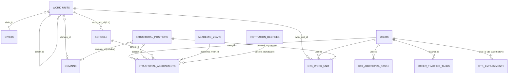
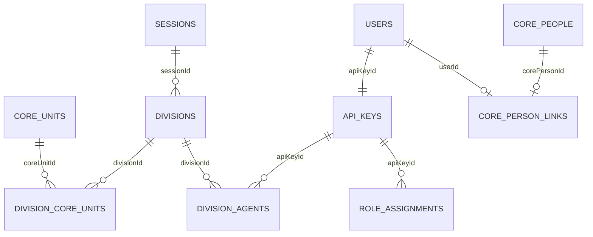

# 35a. Pemetaan Struktur Organisasi ALIM Core ke ALIM Connect

> **Status:** audit dan rancangan, 2026-11-21. **Disetujui pemilik sistem sebagai baseline arsitektur
> integrasi pada 2026-11-21.** Persetujuan ini mencakup pemetaan dan prinsipnya, bukan implementasi:
> tidak ada perubahan kode, migration, endpoint, database, maupun deployment — baik di ALIM Connect
> maupun di ALIM Core. Keputusan D2, D5, D9, dan D12 ditetapkan pada tanggal yang sama (§12.1);
> keputusan lain tetap terbuka.
>
> **Hubungan dengan dokumen lain:** [35](./35-rbac-and-teams-design.md) menetapkan RBAC dan tim
> Fase 1 (sudah diimplementasikan sampai Fase 1a). Dokumen ini menjawab satu pertanyaan yang sengaja
> ditunda di sana: bagaimana struktur organisasi ALIM Core nantinya dipakai ALIM Connect tanpa
> membangun master organisasi duplikat. [34](./34-alim-connect-audit.md) §34.5 sudah menetapkan
> batas integrasi dan menempatkannya di Fase 4; dokumen ini mengisi detail pemetaannya.
> [35b](./35b-alim-core-api-coordination-and-safety-plan.md) adalah paket koordinasi kebutuhan API
> dan Production Safety Plan yang menjadi gerbang D9.
>
> **Sumber yang dibaca (read-only):** repository ALIM Core pada `HEAD d38ea6e3` — migration, model,
> route, middleware integrasi, dan tiga dokumen di `docs/integration/`
> (`alim-connect-api-design.md`, `alim-core-organization-data-audit.md`,
> `alim-connect-engineering-review.md`); repository ALIM Connect pada `HEAD 5048bb9ec` — entity,
> `permissions.ts`, `permission.service.ts`, `assignments.service.ts`, `docs/05`, `docs/33`,
> `docs/34`, `docs/35`. Log verifikasi ada di [Lampiran A](#lampiran-a-log-verifikasi).

## Legenda status

Setiap pemetaan di dokumen ini membawa satu status:

| Status      | Arti                                                           |
| ----------- | -------------------------------------------------------------- |
| `CORE`      | Sudah tersedia di ALIM Core (diverifikasi pada kode/migration) |
| `CONNECT`   | Sudah tersedia di ALIM Connect                                 |
| `RANCANGAN` | Baru berupa rancangan di dokumen ini                           |
| `BELUM`     | Belum tersedia di kedua sistem                                 |
| `KEPUTUSAN` | Membutuhkan keputusan pemilik sistem sebelum dapat ditetapkan  |

---

## 1. Executive Summary

ALIM Core sudah memiliki model organisasi yang kaya dan layak menjadi **single source of truth**.
Yang **belum** ada adalah jalur aksesnya: desain API integrasi di
`docs/integration/alim-connect-api-design.md` adalah **rancangan**, bukan implementasi. Di
`routes/api.php`, rute integrasi antar-aplikasi yang ada hanyalah `/api/pos/v1` dan
`/api/recruitment/v1` (di samping `/api/mobile/v1` untuk aplikasi mobile); tidak ada satu pun rute
`/api/connect/v1` atau `/organization/*`. Karena itu kesimpulan dokumen ini dipisahkan menjadi dua:
**pemetaan konseptual dapat dibekukan sekarang**, sedangkan **implementasi menunggu Core**.

Enam kesimpulan utama:

1. **`work_units` adalah tulang punggung organisasi, tetapi bukan satu-satunya lapis.** Ada empat
   lapis yang harus dibedakan: unit organisasi (`work_units`), unit akademik (`schools` dan rumpun
   akademik), katalog jabatan (`structural_positions`), dan penugasan (`structural_assignments`,
   `gtk_work_unit`, tugas tambahan, penugasan akademik). Connect tidak boleh meruntuhkannya menjadi
   satu tabel.
2. **Tidak ada "tim" di Core.** Core tidak memiliki `teams`/`team_members`; "tim" di sana
   direpresentasikan sebagai tugas tambahan dan penugasan per modul. Karena itu `divisions` di
   Connect tetap konsep operasional milik Connect, dan relasinya ke unit Core adalah
   **many-to-many yang dinyatakan eksplisit**, bukan turunan otomatis.
3. **`divisions` di Connect bukan `divisis` di Core.** Namanya mirip, maknanya berbeda: `divisis`
   Core adalah pengelompokan departemen institusi (`kode` unik seperti `PAH-SP`), sedangkan
   `divisions` Connect adalah tim layanan di balik satu nomor WhatsApp dan terikat pada `sessionId`.
   Menyamakan keduanya akan menghasilkan master ganda dan routing yang salah.
4. **Identitas Core, akun Connect, dan aktor otorisasi adalah tiga hal berbeda.** `users.id` di Core
   (UUID GTK), `users.id` di Connect (akun dashboard), dan `api_keys.id` di Connect (aktor
   otorisasi) tidak boleh dianggap satu. Penghubungnya harus tabel tautan eksplisit dengan
   verifikasi, bukan pencocokan email implisit.
5. **Hanya `structural_assignments` yang punya siklus hidup penuh.** Ia memiliki `status`,
   `start_date`/`end_date`, soft delete, dan unique key. `gtk_work_unit` tidak punya status, tanggal,
   maupun tombstone: baris yang hilang berarti penempatan berakhir, dan `id` baris berubah bila
   baris dibuat ulang. Connect tidak boleh memakai penempatan sebagai sumber kewenangan.
6. **Scope `unit` tetap dimatikan.** Fase 1a menolak `scopeType='unit'` dengan `400`. Rancangan di
   §7 mengikat `unit` ke **UUID `work_units` Core**, bukan ke tabel unit lokal, tetapi aktivasi tetap
   menunggu tiga prasyarat: read model, keterkaitan kontak ke unit, dan keputusan pemilik sistem.

Yang **tidak berubah** oleh dokumen ini — dan tidak boleh diubah saat implementasi nanti:
`role_assignments`, `PermissionService`, jembatan `hasPermission`, `authzVersion`, invalidasi cache,
fingerprint otorisasi WebSocket, dan seluruh kontrak endpoint Fase 1a. Tidak ada Fase 1b/1c di sini.

Keputusan pemilik sistem pada 2026-11-21 (rincian dan kutipan di §12.1): assignment dan domain Core
hanya menjadi informasi referensi bagi Connect (D2); tidak ada hubungan langsung `session`–unit (D5);
implementasi API menjadi tanggung jawab tim Core dan **belum disetujui**, dengan Production Safety
Plan sebagai gerbang (D9); scope `unit` tetap ditolak `400` (D12).

| Area                         | Kondisi hari ini                                        | Dampak ke rancangan                           |
| ---------------------------- | ------------------------------------------------------- | --------------------------------------------- |
| API organisasi Core          | `BELUM` — hanya rancangan di `docs/integration/`        | Integrasi tidak dapat dimulai; kontrak dulu   |
| Struktur organisasi Core     | `CORE` — unit, sekolah, jabatan, penempatan, assignment | Cukup untuk pemetaan; tidak perlu master baru |
| Tim operasional Connect      | `CONNECT` — `divisions` per sesi                        | Many-to-many ke unit; bukan 1:1               |
| Identitas GTK ↔ akun Connect | `BELUM`                                                 | Perlu tabel tautan + verifikasi               |
| Scope `unit` di RBAC Connect | `BELUM` — ditolak `400`                                 | Rancangan §7; aktivasi ditunda                |
| Feed perubahan / tombstone   | `BELUM` di Core                                         | Sinkronisasi bertahap: snapshot lalu polling  |

---

## 2. Ringkasan Struktur Organisasi ALIM Core

### 2.1 Empat lapis yang harus dibedakan

| Lapis           | Entitas aktual                                                                                                                                                                                     | Fungsi                                                                               | Status |
| --------------- | -------------------------------------------------------------------------------------------------------------------------------------------------------------------------------------------------- | ------------------------------------------------------------------------------------ | ------ |
| Unit organisasi | `work_units`                                                                                                                                                                                       | Satuan kerja berjenjang (`parent_id`), bertipe, terhubung ke `divisis` dan `domains` | `CORE` |
| Unit akademik   | `schools`, `academic_years`, `grade_levels`, `study_groups`, `subjects`                                                                                                                            | Satuan pendidikan dan turunannya; hampir semua data akademik memakai `school_id`     | `CORE` |
| Katalog jabatan | `structural_positions`, `jenis_gtk`, `additional_task_types`                                                                                                                                       | Master posisi, kategori GTK, jenis tugas tambahan                                    | `CORE` |
| Penugasan       | `structural_assignments`, `gtk_work_unit`, `gtk_additional_tasks`, `other_teacher_tasks`, `teaching_assignments`, `homeroom_assignments`, `coordinator_assignments`, `dormitory_staff_assignments` | Siapa ditugaskan di mana, untuk apa, sampai kapan                                    | `CORE` |

### 2.2 Inventaris entitas yang relevan

| Entitas                       | Primary key | Natural key                                                 | Siklus hidup                       | Soft delete            | Siap disinkronkan | Status  |
| ----------------------------- | ----------- | ----------------------------------------------------------- | ---------------------------------- | ---------------------- | ----------------- | ------- |
| `work_units`                  | `id` UUID   | `code` unik                                                 | `is_active`                        | Ya                     | Sebagian          | `CORE`  |
| `divisis`                     | `id` UUID   | `kode` unik                                                 | `is_active`                        | Ya                     | Sebagian          | `CORE`  |
| `domains`                     | `id` UUID   | `code` unik (14 domain resmi)                               | `is_active`                        | Ya                     | Ya                | `CORE`  |
| `schools`                     | `id` UUID   | `npsn` unik                                                 | `is_active`                        | **Tidak**              | Sebagian          | `CORE`  |
| `structural_positions`        | `id` UUID   | `code` unik                                                 | `is_active`                        | **Tidak**              | Sebagian          | `CORE`  |
| `users` (GTK)                 | `id` UUID   | `email` unik                                                | `is_active`                        | Ya                     | Ya                | `CORE`  |
| `gtk_employments`             | `id` UUID   | —                                                           | `status_kepegawaian`               | Tidak                  | Sebagian          | `CORE`  |
| `gtk_work_unit`               | `id` baris  | `(user_id, work_unit_id)` unik                              | **Tidak ada**                      | Tidak                  | Sebagian          | `CORE`  |
| `structural_assignments`      | `id` UUID   | `(user_id, position_id, school_id, academic_year_id)`       | `status` + `start_date`/`end_date` | Ya                     | Ya                | `CORE`  |
| `gtk_additional_tasks`        | `id` UUID   | Tidak ada unique                                            | `tmt`/`tst`                        | Tidak                  | Sebagian          | `CORE`  |
| `other_teacher_tasks`         | `id` UUID   | `(teacher_id, academic_year_id, task_code, study_group_id)` | `is_active`                        | Tidak                  | Sebagian          | `CORE`  |
| `institution_decrees`         | `id` UUID   | `decree_number` unik                                        | `status`                           | Kolom ada, trait tidak | Sebagian          | `CORE`  |
| `academic_years`              | `id` UUID   | `(school_id, name, semester)`                               | `is_active`                        | Tidak                  | Ya                | `CORE`  |
| `teaching_assignments`        | `id` UUID   | `(decree_id, teacher_id, study_group_id, subject_id)`       | `status`                           | —                      | Belum             | `CORE`  |
| `homeroom_assignments`        | `id` UUID   | `(decree_id, study_group_id)`                               | `status` + tanggal                 | —                      | Belum             | `CORE`  |
| `coordinator_assignments`     | `id` UUID   | `(decree_id, teacher_id, coordination_area)`                | `status` + tanggal                 | Ya                     | Belum             | `CORE`  |
| `dormitory_staff_assignments` | `id` UUID   | —                                                           | `status` + tanggal                 | Ya                     | Belum             | `CORE`  |
| Tim generik (`teams`)         | —           | —                                                           | —                                  | —                      | —                 | `BELUM` |

### 2.3 Diagram relasi entitas (Core)



Catatan diagram: `USERS` adalah baris GTK. Tidak ada entitas yayasan, pesantren, maupun tim; keduanya
hanya muncul sebagai nilai (`level`, `status_kepegawaian`) atau sebagai teks.

### 2.4 Sepuluh fakta yang membatasi rancangan

1. **`work_units.parent_id` tidak memiliki foreign key.** Pohon dapat berisi yatim dan siklus;
   Connect wajib menangani `parent_id` yang tidak menunjuk baris mana pun.
2. **`work_units.type` bukan enum lagi.** Migrasi `2026_07_31_120800` mengubah kolom menjadi varchar
   dan menambah `Pelayanan Kesehatan`. Nilai lama: `Unsur Pimpinan`, `Unit Akademik`,
   `Unit Penunjang Akademik`, `Unit Administrasi`, `Unit Pelayanan`, `Unit Humas Publikasi`.
   Connect tidak boleh memvalidasi tipe secara tertutup.
3. **`work_units` punya dua sumbu tambahan:** `divisi_id` (FK `divisis`, `nullOnDelete`) dan
   `domain_id` (FK `domains`, `nullOnDelete`). Keduanya boleh null.
4. **`schools.work_unit_id` wajib dan `cascadeOnDelete`, tanpa unique.** Satu unit dapat memiliki
   banyak sekolah — relasi **one-to-many**, meskipun model `WorkUnit::school()` bertipe `hasOne`.
5. **`schools` dan `structural_positions` tidak memiliki soft delete.** Penghapusan bersifat keras
   dan baris hilang dari daftar; tanpa change ledger, penghapusan hanya terdeteksi lewat
   rekonsiliasi.
6. **`structural_positions.domain_id` boleh null dan tidak ada di `$fillable`.** Seeder mengirim
   `domain_id` lewat `updateOrCreate()`, sehingga nilai itu berpotensi tidak tersimpan. Connect tidak
   boleh mengasumsikan setiap jabatan punya domain.
7. **`gtk_work_unit` tidak punya status, tanggal, maupun `deleted_at`.** Aktif selama baris ada.
   `is_primary` tidak dijamin tunggal per user.
8. **`structural_assignments` adalah sumber kewenangan struktural.** `status` (`active|inactive|ended`),
   `start_date` wajib, `end_date` dan `decree_id` boleh null, soft delete ada, unique key ada.
9. **Tugas tambahan berasal dari dua tabel yang berbeda.** `gtk_additional_tasks` (legacy, level user,
   tanpa `school_id`/`academic_year_id`) dan `other_teacher_tasks` (per sekolah/tahun ajaran, punya
   unique key). Tidak ada unique lintas tabel: kunci konsumsi harus `(source, id)`.
10. **Core menghitung permission dari role Spatie dan/atau domain jabatan**, lalu menyimpannya di
    `permission_snapshots`. Tidak ada pembatasan data generik berbasis hierarki unit; yang ada adalah
    scope per sekolah (`OrganizationContext.schoolId`) dan pengecekan domain.

### 2.5 Status kesiapan Core untuk integrasi

| Area                           | Verdict                    | Alasan                                                                        |
| ------------------------------ | -------------------------- | ----------------------------------------------------------------------------- |
| Identifier entity              | Siap dengan catatan        | UUID konsisten; `structural_positions.id` tidak stabil bila seeder dijalankan |
| Relasi `work_units`–`schools`  | Siap dengan catatan        | Ada, tetapi 1:N dan `schools` tanpa soft delete                               |
| GTK ↔ `gtk_work_unit`          | Siap baca, belum siap sync | Tidak ada status/tanggal/tombstone                                            |
| GTK ↔ `structural_assignments` | Siap                       | Status, tanggal, soft delete, unique key                                      |
| Histori dan soft delete        | Belum siap                 | Tidak seragam; banyak entity hard delete                                      |
| Feed perubahan                 | Belum siap                 | Tidak ada change ledger; `integration_event_log` bukan feed eksternal         |
| Endpoint integrasi organisasi  | Belum ada                  | Hanya `/api/pos/v1` dan `/api/recruitment/v1`                                 |

---

## 3. Pemetaan Entitas Core dan Connect

### 3.1 Tabel pemetaan utama

| Konsep Connect           | Sumber Core                                   | Kardinalitas                       | Identifier yang dipakai             | Status      | Catatan                                              |
| ------------------------ | --------------------------------------------- | ---------------------------------- | ----------------------------------- | ----------- | ---------------------------------------------------- |
| Organizational Unit      | `work_units`                                  | 1 unit → N anak (self)             | `work_units.id` (UUID)              | `CORE`      | `code` hanya atribut; `parent_id` tanpa FK           |
| School / Education Unit  | `schools`                                     | 1 unit → N sekolah                 | `schools.id` (UUID)                 | `CORE`      | `npsn` natural key; tanpa soft delete                |
| Position                 | `structural_positions`                        | 1 posisi → N assignment            | `structural_positions.id` (UUID)    | `CORE`      | `code` unik; `domain_id` boleh null                  |
| Organizational Placement | `gtk_work_unit`                               | 1 orang → N unit; 1 unit → N orang | `gtk_work_unit.id` (baris)          | `CORE`      | Tanpa status/tanggal; baris hilang = berakhir        |
| Structural Assignment    | `structural_assignments`                      | 1 orang → N assignment             | `structural_assignments.id` (baris) | `CORE`      | Satu-satunya sumber dengan siklus hidup penuh        |
| Additional Assignment    | `gtk_additional_tasks`, `other_teacher_tasks` | 1 orang → N tugas                  | `(source, id)` komposit             | `CORE`      | Dua sumber; jangan digabung menjadi satu tabel lokal |
| Person / Employee        | `users` (+ `gtk_profiles`, `gtk_employments`) | 1 orang = 1 baris `users`          | `users.id` (UUID)                   | `CORE`      | `gtk_profiles` adalah atribut, bukan identitas       |
| Organizational Hierarchy | `work_units.parent_id`                        | Pohon, kedalaman bebas             | `work_units.id`                     | `CORE`      | Tidak ada FK; dapat yatim/siklus                     |
| Domain Reference         | `domains`                                     | 1 domain → N posisi/unit           | `domains.id` (UUID), `code`         | `CORE`      | 14 domain; bukan permission Connect                  |
| Operational Team         | — (tidak ada di Core)                         | —                                  | —                                   | `CONNECT`   | `divisions`, terikat `sessionId`                     |
| Team membership          | —                                             | —                                  | —                                   | `CONNECT`   | `division_agents.apiKeyId`                           |
| Person ↔ Account link    | —                                             | —                                  | —                                   | `BELUM`     | Perlu tabel tautan (§5)                              |
| Unit ↔ Team link         | —                                             | —                                  | —                                   | `RANCANGAN` | Perlu tabel penghubung (§4)                          |

### 3.2 Organizational Unit → `work_units`

**Yang dibutuhkan Connect:** `id`, `code`, `name`, `type`, `parent_id`, `divisi` (opsional),
`domain` (opsional), `is_active`, `updated_at`. Tidak lebih.

**Keputusan pemetaan:** satu baris read model per `work_units.id`; `code` disimpan sebagai atribut
pencarian dan **tidak pernah** dipakai sebagai kunci. Hierarki direkonstruksi dari `parent_id` di
sisi Connect, dengan penanganan yatim (baris dengan parent tidak dikenal ditempatkan di akar dan
ditandai).

**Yang tidak dilakukan:** membuat tabel `organizations`/`units` baru di Connect yang dapat menampung
unit yang tidak ada di Core; menyimpan `path` materialized yang dihitung sendiri sebagai sumber
kebenaran (boleh sebagai cache, wajib dapat dibangun ulang dari `parent_id`).

Status: `CORE` untuk data, `RANCANGAN` untuk read model.

### 3.3 School / Education Unit → `schools`

**Keputusan pemetaan:** sekolah adalah entitas tersendiri, **bukan** unit. `school.work_unit_id`
menjadi penghubung; Connect menyimpan `workUnitId` sebagai kolom biasa (bukan FK lintas sistem).

**Aturan kardinalitas:** satu unit dapat memiliki banyak sekolah. Setiap tampilan Connect yang
menampilkan "unit beserta sekolahnya" wajib memakai daftar, bukan satu nilai tunggal. Ini berlaku
meskipun data hari ini kebanyakan satu sekolah per unit: mengikuti `hasOne` akan kehilangan sekolah
pada unit gabungan.

**Yang tidak dilakukan:** menyalin `npsn` ke `work_units.code`; memperlakukan sekolah sebagai scope
RBAC pada fase ini (lihat §7).

Status: `CORE` untuk data, `RANCANGAN` untuk read model.

### 3.4 Position → `structural_positions`

**Keputusan pemetaan:** jabatan adalah **katalog**, bukan identitas orang dan bukan penugasan.
Connect memakainya untuk menampilkan "jabatan apa" pada penugasan, dan tidak pernah menurunkan
permission Connect darinya.

**Risiko yang harus dibawa ke desain:** `JenisGtkSeeder` menghapus seluruh `structural_positions`
lalu membuat ulang, sementara FK `structural_assignments.position_id` memakai `cascadeOnDelete`.
Bila seeder dijalankan di lingkungan berisi data, assignment dapat hilang dan UUID posisi berubah.
Konsekuensi untuk Connect: **jangan menyimpan referensi posisi sebagai dasar keputusan apa pun**;
simpan hanya untuk tampilan, dan perlakukan posisi yang hilang sebagai penugasan yang tidak dapat
ditampilkan (bukan sebagai penghapusan hak akses).

Status: `CORE` untuk data, `RANCANGAN` untuk read model.

### 3.5 Organizational Placement → `gtk_work_unit`

**Keputusan pemetaan:** penempatan dipakai untuk menjawab "orang ini berada di unit mana", bukan
"orang ini berhak apa". Karena tidak ada status dan tanggal:

- baris yang tidak lagi dikembalikan Core ditandai berakhir di read model (`lastSeenSyncRun`), bukan
  dihapus;
- `id` baris berubah bila baris dibuat ulang, sehingga rekonsiliasi tidak boleh mengandalkan `id`
  saja — natural key `(personId, unitId)` dipakai untuk mendeteksi penggantian;
- `is_primary` tidak dijamin tunggal; Connect memilih satu secara deterministik (yang terbaru, lalu
  `id` terkecil) hanya untuk tampilan, dan tidak menyimpannya sebagai fakta.

Status: `CORE` untuk data, `RANCANGAN` untuk read model.

### 3.6 Structural Assignment → `structural_assignments`

**Keputusan pemetaan:** ini satu-satunya sumber yang boleh dipakai untuk menyatakan "masih menjabat".
Connect menyimpan `status`, `startDate`, `endDate`, `decreeId`, dan menghitung `isEffective` sendiri
dengan aturan yang sama seperti Core:

```
status == 'active'
AND start_date <= hari ini
AND (end_date IS NULL OR end_date >= hari ini)
AND deleted_at IS NULL
```

`workUnitId` **diturunkan** dari `school.work_unit_id`, bukan kolom tersimpan. Bila sekolah tidak
dikenal (mis. sudah dihapus keras), assignment tetap disimpan dengan `workUnitId` null dan ditandai.

Status: `CORE` untuk data, `RANCANGAN` untuk read model.

### 3.7 Additional Assignment → dua sumber

**Keputusan pemetaan:** Connect mengonsumsi keduanya sebagai satu **jenis** data dengan dua sumber,
memakai kunci komposit `(source, id)` di read model. `source` hanya boleh bernilai
`gtk_additional_tasks` atau `other_teacher_tasks`.

| Field seragam | `gtk_additional_tasks`     | `other_teacher_tasks`     |
| ------------- | -------------------------- | ------------------------- |
| `personId`    | `user_id`                  | `teacher_id`              |
| `unitId`      | `work_unit_id`             | `work_unit_id`            |
| `schoolId`    | null (tidak ada kolom)     | `school_id`               |
| `yearId`      | null                       | `academic_year_id`        |
| `taskTypeId`  | `additional_task_type_id`  | `additional_task_type_id` |
| `taskName`    | `nama_tugas`               | `task_name`               |
| `taskCode`    | null                       | `task_code`               |
| `startDate`   | `tmt`                      | null                      |
| `endDate`     | `tst`                      | null                      |
| `isActive`    | `tst` null atau ≥ hari ini | `is_active`               |

**Yang tidak dilakukan:** mengisi `schoolId`/`yearId` untuk sumber legacy dengan menebak dari
`decree_id`; menggabungkan kedua tabel menjadi satu tabel lokal bernama `additional_tasks` yang
kehilangan asal-usulnya.

Status: `CORE` untuk data, `RANCANGAN` untuk read model.

### 3.8 Person / Employee → `users` Core

**Keputusan pemetaan:** orang = baris `users` Core. `gtk_profiles` dan `gtk_employments` adalah
atribut orang, bukan identitas. `gtk_employments` dapat berisi banyak baris per user (tidak ada
unique pada `user_id`), sehingga "status kepegawaian" harus dipilih secara deterministik: baris
dengan `tmt` terbaru, lalu `id` terkecil.

**Yang tidak dilakukan:** memakai `email`, `nupy`, atau `nik` sebagai kunci; membuat entitas `person`
baru di Connect yang dapat berdiri sendiri tanpa Core.

Status: `CORE` untuk data, `RANCANGAN` untuk read model dan tabel tautan.

### 3.9 Organizational Hierarchy → `work_units.parent_id`

**Keputusan pemetaan:** hierarki dibaca dari `parent_id` dan dibangun ulang di Connect. Karena tidak
ada FK, read model wajib menangani tiga kasus: parent tidak dikenal (angkat ke akar, tandai
`orphan`), siklus (potong pada kunjungan kedua, tandai `cycle`), dan kedalaman tidak wajar (batasi
untuk tampilan).

**Yang tidak dilakukan:** menyimpan hasil traversal sebagai satu-satunya sumber; menolak seluruh
sinkronisasi karena satu baris yatim.

Status: `CORE` untuk data, `RANCANGAN` untuk penanganan.

### 3.10 Domain Reference → `domains`

**Keputusan pemetaan:** domain disimpan sebagai **referensi baca** (`domainId`, `code`, `name`) pada
unit dan posisi. Domain **bukan** permission Connect dan tidak dipetakan ke role Connect. Keputusan
D2 (2026-11-21) menetapkan bahwa assignment dan domain Core hanya boleh dipakai sebagai informasi
referensi, konteks, dan tampilan — bukan sumber pemberian permission Connect secara otomatis.

Status: `CORE` untuk data, `RANCANGAN` untuk pemakaiannya (D2: referensi dan tampilan saja, tidak
dipetakan ke role Connect).

### 3.11 Pemetaan yang ditolak

| Usulan                                              | Alasan ditolak                                                                                                                            |
| --------------------------------------------------- | ----------------------------------------------------------------------------------------------------------------------------------------- |
| `work_units` → `divisions` otomatis                 | Unit institusi ≠ tim operasional; satu unit dapat dilayani beberapa tim dan sebaliknya                                                    |
| `schools` diperlakukan sebagai `work_units`         | Sekolah adalah unit akademik dengan `work_unit_id`; menyamakan keduanya menghapus hierarki                                                |
| Teks `jabatan` sebagai position id                  | Teks dapat berubah dan tidak memberi kewenangan; gunakan `position_id`/`structural_assignments.id`                                        |
| `gtk_work_unit` sebagai sumber kewenangan           | Tidak ada status, tanggal, maupun tombstone                                                                                               |
| Dua sumber tugas tambahan digabung                  | Kehilangan asal-usul dan kunci; wajib `(source, id)`                                                                                      |
| Domain Core → permission Connect                    | Dua model otorisasi berbeda; butuh keputusan dan tabel pemetaan tersendiri                                                                |
| Memakai API POS/Recruitment sebagai jalur sementara | Kunci integrasi POS/Recruitment adalah milik konsumen lain; mencampurnya melanggar least privilege dan tetap tidak menyediakan assignment |
| Tabel `units`/`organizations` lokal di Connect      | Master duplikat; melanggar prinsip single source of truth                                                                                 |

### 3.12 Yang tidak boleh dibuat di Connect

- Tabel master unit, sekolah, jabatan, atau orang yang dapat menampung data yang tidak berasal dari
  Core.
- Tabel `teams` paralel di samping `divisions`.
- Kolom `unitId` pada `sessions` atau `inbox_conversations` yang diisi otomatis dari Core tanpa
  keterkaitan eksplisit.
- Pemetaan `domains` Core ke `role_assignments.role`.

---

## 4. Perbedaan Organizational Unit dan Operational Team

### 4.1 Definisi

| Aspek            | Organizational Unit (Core)              | Operational Team (Connect)                  |
| ---------------- | --------------------------------------- | ------------------------------------------- |
| Pertanyaan       | "Bagian mana dari institusi ini?"       | "Siapa yang menjawab pelanggan ini?"        |
| Tabel            | `work_units`                            | `divisions`                                 |
| Cakupan          | Institusi, lintas nomor, lintas layanan | Satu `sessionId` (satu nomor WhatsApp)      |
| Hierarki         | Pohon lewat `parent_id`                 | Datar; `sortOrder` untuk menu               |
| Keanggotaan      | Penempatan/assignment GTK di Core       | `division_agents` (per `apiKeyId`)          |
| Kewenangan       | Domain dan role Core                    | Permission Connect lewat `role_assignments` |
| Sumber kebenaran | ALIM Core                               | ALIM Connect                                |
| Contoh           | "Unit Akademik SMP IT Putra"            | "CS SMP Putra" pada nomor 0812-…            |

### 4.2 Mengapa tidak one-to-one

Tiga skenario nyata yang mematahkan asumsi 1:1:

1. **Satu unit, beberapa tim.** Unit yang sama dilayani tim CS pagi dan tim CS malam, atau tim
   penerimaan santri dan tim layanan wali santri. Semuanya menunjuk unit yang sama.
2. **Satu tim, beberapa unit.** Nomor layanan bersama menampung pertanyaan dari beberapa unit; menu
   dan kata kunci mengarahkan ke `division` yang sama.
3. **Satu unit, beberapa nomor.** Bila unit punya nomor sendiri dan juga dilayani nomor bersama,
   akan ada dua `divisions` (karena `divisions.sessionId` wajib) yang menunjuk unit yang sama.

Karena `divisions` terikat pada `sessionId` dan unik pada `(sessionId, name)`, relasi yang benar
adalah **many-to-many antara `work_units` dan `divisions`**, dengan `divisions` tetap milik Connect.

### 4.3 Rancangan relasi



Tabel penghubung yang diusulkan (koneksi `data`, `RANCANGAN`):

| Kolom        | Tipe        | Aturan                                                  |
| ------------ | ----------- | ------------------------------------------------------- |
| `id`         | uuid        | primary key                                             |
| `divisionId` | varchar(36) | FK `divisions` `CASCADE`                                |
| `coreUnitId` | varchar(36) | UUID `work_units`; **tanpa FK** (lintas sistem)         |
| `isPrimary`  | boolean     | default `false`; penanda tampilan, bukan aturan routing |
| `createdAt`  | datetime    | —                                                       |
| `updatedAt`  | datetime    | —                                                       |

Unique `(divisionId, coreUnitId)`; index `(coreUnitId)`.

**Kebijakan yang diusulkan:**

- Tautan dibuat **manual** oleh admin (atau disarankan sistem, dikonfirmasi manusia). Tidak ada
  pembuatan `divisions` otomatis dari `work_units`.
- Satu `division` boleh menautkan nol unit (tim lintas unit atau belum dipetakan). Nol tautan bukan
  error.
- Tautan tidak mengubah permission siapa pun pada Fase 1/2/3. Ia hanya dipakai untuk tampilan,
  filter laporan, dan (nanti) routing berbasis unit.
- Bila unit hilang dari Core, tautan ditandai `orphan` dan ditampilkan sebagai peringatan; tidak
  dihapus otomatis dan tidak memutus routing yang sedang berjalan.

### 4.4 Perangkap nama: `divisis` Core vs `divisions` Connect

`divisis` di Core adalah pengelompokan departemen institusi dengan `kode` unik (contoh:
`PAH-SP`, `Satuan Pendidikan`). `divisions` di Connect adalah tim layanan pada satu nomor. Keduanya
berbagi kata "divisi" tetapi tidak berbagi makna, kardinalitas, maupun pemilik.

Aturan: **jangan pernah** menyamakan `divisis.id` dengan `divisions.id`, dan jangan memberi nama
kolom `divisiId` pada tabel Connect yang menunjuk Core. Bila `divisis` Core dibutuhkan untuk
tampilan, simpan sebagai `coreDivisiId`/`coreDivisiCode` pada read model unit — bukan pada
`divisions`.

### 4.5 Session dan chat

`divisions` hidup di dalam satu sesi. Chat masuk ke `inbox_conversations` dengan `divisionId` dan
`assigneeKeyId`; keduanya konsep operasional Connect. Unit Core tidak muncul di jalur chat sampai
ada keterkaitan kontak → unit (Fase 3/5, di luar dokumen ini). Karena itu:

- menautkan `sessionId` ke unit **tidak dilakukan**; D5 (2026-11-21) menetapkan bahwa hubungan
  division dengan unit ditangani lewat mapping eksplisit, dan satu division tidak diasumsikan
  mewakili satu unit;
- scope `unit` belum dapat mengekang inbox sampai keterkaitan kontak tersedia (§7.4).

---

## 5. Hubungan Person, GTK, Account, dan API Key

### 5.1 Empat identitas dan penghubungnya

| Identitas            | Sistem  | Tabel/field        | Arti                                                                  | Status    |
| -------------------- | ------- | ------------------ | --------------------------------------------------------------------- | --------- |
| GTK / person         | Core    | `users.id` (UUID)  | Orang yang dipekerjakan; atribut di `gtk_profiles`, `gtk_employments` | `CORE`    |
| Akun dashboard       | Connect | `users.id` (UUID)  | Kredensial manusia untuk masuk dashboard                              | `CONNECT` |
| Aktor otorisasi      | Connect | `api_keys.id`      | Yang dibaca `role_assignments`, guard, dan fingerprint                | `CONNECT` |
| Sesi login           | Connect | `user_sessions.id` | Token `owa_s1_…`; turunan akun                                        | `CONNECT` |
| Tautan person ↔ akun | —       | —                  | Penghubung eksplisit antara dua identitas pertama                     | `BELUM`   |

`users.apiKeyId` di Connect unik: satu akun memiliki tepat satu key. Key mesin (integrasi) tidak
memiliki akun dan tidak memiliki person; ia tetap aktor sah dengan `role_assignments` sendiri.

### 5.2 Aturan identitas

1. **`users.id` Core adalah identitas kanonik orang.** Jangan membuat UUID orang baru di Connect.
2. **Email bukan kunci.** Email dapat berubah, dipakai bersama, atau berbeda antar sistem. Email
   hanya petunjuk untuk pencocokan, bukan bukti.
3. **Tautan disimpan di koneksi `main`** karena ia menyentuh identitas akun dan harus ikut backup
   `main.sqlite`. `corePersonId` disimpan sebagai kolom biasa **tanpa FK** (Core bukan database
   lokal).
4. **Satu akun Connect paling banyak satu person Core; satu person Core paling banyak satu akun
   Connect.** Keduanya unique index. Ini mencegah dua akun berbagi satu GTK dan mencegah satu akun
   berpindah orang tanpa jejak.
5. **Tautan dapat dicabut, bukan dihapus.** Pencabutan menyimpan alasan dan pelaku; riwayat tautan
   tetap ada untuk audit.
6. **Akun tanpa tautan adalah sah.** Staf operasional yang bukan GTK (mis. agen CS pihak ketiga)
   harus tetap bisa bekerja. Scope berbasis unit hanya berlaku bagi akun yang tertaut.

### 5.3 Rancangan tabel tautan

`core_person_links` (koneksi `main`, `RANCANGAN`):

| Kolom                   | Tipe        | Aturan                                      |
| ----------------------- | ----------- | ------------------------------------------- |
| `id`                    | varchar(36) | primary key                                 |
| `userId`                | varchar(36) | unique; akun Connect                        |
| `corePersonId`          | varchar(36) | unique; UUID `users` Core                   |
| `status`                | varchar(16) | `active`, `stale`, `revoked`                |
| `linkSource`            | varchar(16) | `manual`, `suggested_email`, `import`       |
| `verifiedAt`            | datetime    | kapan manusia/verifikasi menyetujui         |
| `verifiedByKeyId`       | varchar(36) | key yang menyetujui                         |
| `lastCheckedAt`         | datetime    | kapan terakhir dicocokkan dengan read model |
| `revokedAt`             | datetime    | null selama aktif                           |
| `createdAt`/`updatedAt` | datetime    | —                                           |

Index tambahan: `(status)`, `(corePersonId)`.

### 5.4 Alur penautan yang diusulkan

```
Admin membuka akun Connect
  → mencari person Core (nama/email/username) lewat read model
    → sistem menampilkan kandidat + alasan kecocokan
      → admin mengonfirmasi
        → baris core_person_links dibuat (status active, linkSource manual)
          → audit log Connect mencatat penautan
```

Pencocokan otomatis berbasis email **tidak** langsung mengaktifkan tautan; ia hanya menghasilkan
saran (`suggested_email`) yang harus dikonfirmasi. Alasannya: email bersama dan salah ketik akan
menautkan orang yang salah, dan tautan yang salah berpotensi memberi akses ke data unit lain.

### 5.5 Siklus hidup dan kasus tepi

| Kejadian                                     | Perilaku yang diusulkan                                                  | Status      |
| -------------------------------------------- | ------------------------------------------------------------------------ | ----------- |
| Person Core nonaktif (`is_active=false`)     | Tautan menjadi `stale`; akun Connect **tidak** otomatis dinonaktifkan    | `KEPUTUSAN` |
| GTK berhenti (`status_kepegawaian` terminal) | Sama seperti di atas; ditampilkan sebagai peringatan di dashboard        | `KEPUTUSAN` |
| Person Core hilang dari read model           | Tautan `stale`; grant berbasis unit ditandai tidak dapat diverifikasi    | `RANCANGAN` |
| Dua akun menautkan person yang sama          | Ditolak oleh unique index `corePersonId`                                 | `RANCANGAN` |
| Akun dihapus                                 | Tautan ikut terhapus (CASCADE) atau ditandai `revoked` — perlu keputusan | `KEPUTUSAN` |
| Nama/email berubah di Core                   | Read model diperbarui; `users.name` Connect tidak ditimpa otomatis       | `RANCANGAN` |

---

## 6. Pemetaan Assignment

### 6.1 Tiga keluarga assignment dan maknanya

| Keluarga             | Tabel Core                                                                                               | Menjawab                                      | Punya siklus hidup | Boleh jadi dasar kewenangan Connect | Status |
| -------------------- | -------------------------------------------------------------------------------------------------------- | --------------------------------------------- | ------------------ | ----------------------------------- | ------ |
| Penempatan           | `gtk_work_unit`                                                                                          | "Di unit mana orang ini ditempatkan"          | Tidak              | **Tidak**                           | `CORE` |
| Penugasan struktural | `structural_assignments`                                                                                 | "Jabatan struktural apa yang dipegang"        | Ya                 | Tidak pada fase ini (§6.4)          | `CORE` |
| Tugas tambahan       | `gtk_additional_tasks`, `other_teacher_tasks`                                                            | "Tugas/koordinator apa"                       | Sebagian           | **Tidak**                           | `CORE` |
| Penugasan akademik   | `teaching_assignments`, `homeroom_assignments`, `coordinator_assignments`, `dormitory_staff_assignments` | "Mengajar/wali kelas/koordinator/staf asrama" | Ya                 | **Tidak**                           | `CORE` |

Keempatnya tidak boleh digabung menjadi satu tabel "assignment" di Connect tanpa kolom `kind`,
karena makna, kunci, dan masa berlakunya berbeda.

### 6.2 Pemetaan ke konsep Connect

| Sumber Core                  | Ditampilkan sebagai                       | Dipakai untuk                                | Status      |
| ---------------------------- | ----------------------------------------- | -------------------------------------------- | ----------- |
| `gtk_work_unit`              | Unit penempatan pada profil orang         | Tampilan, filter daftar orang per unit       | `RANCANGAN` |
| `structural_assignments`     | Jabatan struktural pada profil orang/unit | Tampilan, filter, indikator "masih menjabat" | `RANCANGAN` |
| `gtk_additional_tasks`       | Tugas tambahan (sumber legacy)            | Tampilan                                     | `RANCANGAN` |
| `other_teacher_tasks`        | Tugas tambahan per sekolah/tahun ajaran   | Tampilan, filter per unit/sekolah            | `RANCANGAN` |
| Penugasan akademik           | Tidak dimodelkan pada fase ini            | —                                            | `BELUM`     |
| `role_assignments` (Connect) | Peran dan scope Connect                   | **Satu-satunya dasar otorisasi Connect**     | `CONNECT`   |

### 6.3 Aturan konsumsi

1. **Kewenangan Connect tetap milik Connect.** Core assignment tidak pernah menambah atau mengurangi
   permission Connect pada Fase 1a–3. Ini menjaga agar kegagalan atau perubahan Core tidak
   mengubah hak akses inbox secara diam-diam.
2. **Penempatan bukan penugasan.** Menampilkan "ditempatkan di unit X" berbeda dari "menjabat
   posisi Y"; UI dan API Connect harus memakai istilah yang berbeda.
3. **Satu orang boleh punya banyak baris.** Tidak ada asumsi "satu unit per orang" maupun "satu
   jabatan per orang".
4. **Baris yang hilang bukan pencabutan hak.** Bila penempatan hilang, tampilan berubah; grant
   Connect tidak berubah sampai admin mencabutnya.

### 6.4 Bila kelak Core assignment ingin dijadikan dasar kewenangan

Ini **tidak** diusulkan sekarang, tetapi perlu dicatat sebagai arah yang mungkin:

- Butuh tabel pemetaan eksplisit `core position/domain → Connect role` yang disetujui manusia.
- Butuh aturan konflik: bila Core mencabut jabatan, apakah grant Connect ikut dicabut otomatis
  (berisiko mengunci operasional) atau hanya ditandai (lebih aman)?
- Butuh jaminan bahwa Core tidak dapat memberi **lebih** dari yang diizinkan kebijakan Connect.
- Karena `structural_positions.id` dapat berubah saat seeder dijalankan, pemetaan berbasis posisi
  harus dapat dipulihkan tanpa kehilangan grant.

Keputusan D2 (2026-11-21): **tidak** untuk saat ini. Assignment dan domain Core hanya menjadi
informasi referensi, konteks, dan tampilan; RBAC Connect tetap menjadi mekanisme otorisasi
operasional sampai ada desain integrasi otorisasi lintas aplikasi yang ditinjau dan disetujui.
Butir-butir di atas karena itu menjadi prasyarat untuk desain tersebut, bukan pekerjaan yang
dijadwalkan.

---

## 7. Rancangan Hubungan Organization Scope dengan RBAC Connect

### 7.1 Kondisi Fase 1a (tidak berubah)

| Aspek                   | Nilai hari ini                                                               | Status    |
| ----------------------- | ---------------------------------------------------------------------------- | --------- |
| `scopeType`             | `global`, `session`, `team`, `object`                                        | `CONNECT` |
| `scopeId` `team`        | `divisions.id`                                                               | `CONNECT` |
| `scopeId` `session`     | `sessions.id`                                                                | `CONNECT` |
| `scopeId` `object`      | chat id (`…@g.us`, `…@c.us`, `…@lid`, …)                                     | `CONNECT` |
| `scopeType='unit'`      | Ditolak `400` dengan pesan yang menyebut Fase 4                              | `CONNECT` |
| Jembatan `@RequireRole` | Penugasan ter-scope dibatasi maksimal OPERATOR                               | `CONNECT` |
| Cache                   | 15 detik, kunci `id + role + authzVersion`, dibatasi `validTo`               | `CONNECT` |
| Invalidasi              | `authzVersion` naik dalam transaksi yang sama; socket diputus setelah commit | `CONNECT` |

### 7.2 Arti `unit` yang diusulkan

- `scopeType = 'unit'`, `scopeId = work_units.id` (UUID Core).
- **Tidak ada tabel unit lokal** dan tidak ada UUID unit yang dibuat Connect.
- `scopeId` divalidasi saat penulisan terhadap read model (`core_units`), bukan terhadap tabel
  Connect. Bila unit tidak ada/`is_active=false`, penulisan ditolak `400`.
- Satu grant `unit` berlaku untuk unit itu saja. Cakupan subtree (termasuk turunan) **bukan**
  default; bila dibutuhkan, ia menjadi properti eksplisit (mis. `includeDescendants`) dan keputusan
  tersendiri (D1).

### 7.3 Dampak ke implementasi RBAC (saat diaktifkan nanti)

| Komponen                       | Perubahan yang diperlukan                                 | Sifat     |
| ------------------------------ | --------------------------------------------------------- | --------- |
| `permissions.ts` `SCOPE_TYPES` | Tambah `'unit'`                                           | Aditif    |
| `accessFromAssignments()`      | `case 'unit': unitIds.add(scopeId)`                       | Aditif    |
| `EffectiveAccess.scope`        | Tambah `unitIds: Set<string>`                             | Aditif    |
| `PermissionService.scope()`    | Kembalikan `unitIds` (diiris dengan fence yang relevan)   | Aditif    |
| `ResourceRef`                  | Tambah `unitId?`                                          | Aditif    |
| `allows()`                     | Cocokkan `resource.unitId` dengan `scope.unitIds`         | Aditif    |
| `bridgeLevel()`                | Tidak berubah: grant `unit` ter-scope → maksimal OPERATOR | Tidak ada |
| DTO/OpenAPI                    | `unit` masuk enum; `scopeId` wajib UUID unit              | Aditif    |
| `docs/06`                      | Dokumentasi tipe scope baru                               | Aditif    |

Tidak ada perubahan pada `role_assignments` (skema), `authzVersion`, fingerprint, atau guard yang
sudah ada. Grant lama tidak terpengaruh karena `unit` belum pernah diterima.

### 7.4 Prasyarat penegakan (mengapa belum bisa diaktifkan)

`unit` baru berguna bila ada objek yang dapat diuji. Hari ini:

| Objek                    | Punya dimensi unit? | Keterangan                                               |
| ------------------------ | ------------------- | -------------------------------------------------------- |
| `sessions`               | Tidak               | Sesi adalah nomor WhatsApp, bukan unit                   |
| `divisions`              | Tidak langsung      | Bisa ditautkan ke unit (§4.3), tetapi tautan bukan scope |
| `inbox_conversations`    | Tidak               | Tidak ada `unitId`; kontak belum dikaitkan ke Core       |
| `messages`               | Tidak               | Turunan chat                                             |
| `campaigns`, `templates` | Tidak               | Tidak punya dimensi organisasi                           |

Karena itu, sampai keterkaitan kontak → unit (Fase 3/5) ada, grant `unit` hanya dapat dipakai untuk
**filter daftar** (mis. daftar orang per unit), bukan untuk mengekang inbox atau chat. Mengaktifkan
`unit` lebih awal akan menciptakan scope yang tampak membatasi tetapi tidak mengekang apa pun —
lebih berbahaya daripada menolaknya.

#### 7.4.1 Gerbang aktivasi (D12)

D12 ditetapkan 2026-11-21: scope `unit` **tetap nonaktif** dan `scopeType=unit` tetap dijawab `400`.
Aktivasi hanya boleh dipertimbangkan setelah **kelima** kondisi berikut terpenuhi dan dibuktikan:

1. API organisasi Core tersedia dan stabil.
2. Sinkronisasi master organisasi dan assignment berjalan.
3. Mapping division Connect dengan unit Core sudah tervalidasi.
4. Objek operasional seperti kontak dan percakapan sudah memiliki keterkaitan unit yang dapat
   ditegakkan.
5. Pengujian isolasi akses lintas unit membuktikan bahwa scope benar-benar membatasi data.

Tidak satu pun dari kelima kondisi ini boleh diganti dengan asumsi. Masing-masing membutuhkan bukti:
hasil uji, laporan sinkronisasi, atau validasi data. Sampai kelimanya ada, `unit` tetap `400` dan
tidak ada perubahan pada RBAC Fase 1a.

### 7.5 Pemetaan konsep organisasi Core ke dimensi scope

| Konsep Core            | Dimensi scope Connect | Alasan                                                         | Status      |
| ---------------------- | --------------------- | -------------------------------------------------------------- | ----------- |
| `work_units`           | `unit`                | Unit institusi adalah fence yang bermakna                      | `RANCANGAN` |
| `schools`              | Tidak (turunan unit)  | Sekolah melekat pada unit; menambah `school` akan menduplikasi | `KEPUTUSAN` |
| `structural_positions` | Tidak                 | Jabatan adalah atribut, bukan fence                            | `KEPUTUSAN` |
| `domains`              | Tidak                 | Model otorisasi berbeda; D2 menetapkan referensi saja          | `RANCANGAN` |
| `divisis` (Core)       | Tidak                 | Bukan tim operasional; jangan dicampur dengan `team`           | `RANCANGAN` |
| `divisions` (Connect)  | `team`                | Sudah berjalan di Fase 1a                                      | `CONNECT`   |

### 7.6 Aturan keselamatan

1. **Fail-closed, bukan fail-open.** Grant `unit` yang menunjuk unit tak dikenal atau nonaktif
   diabaikan (tidak memberi akses) dan dilaporkan sebagai `unresolvedScopes` di `/auth/validate`.
   Grant tidak dihapus otomatis.
2. **Perubahan Core tidak boleh memperluas akses.** Sinkronisasi hanya boleh menambah/mengurangi
   keanggotaan unit; ia tidak boleh menaikkan level jembatan atau mengubah grant `global`.
3. **Tidak ada auto-remap.** Bila unit digabung/dihapus di Core, grant lama tidak dipindahkan ke unit
   lain. Admin harus menetapkan ulang.
4. **Invalidasi tetap lewat `authzVersion`.** Bila kelak sinkronisasi mengubah scope efektif sebuah
   key, penulisannya wajib menaikkan `authzVersion` di transaksi yang sama dan menginvalidasi setelah
   commit — pola yang sudah ada di `AssignmentsService`.

---

## 8. Rancangan Data Synchronization

### 8.1 Matriks kepemilikan data

| Data                             | Pemilik (otoritatif) | Connect menyimpan    | Arah           |
| -------------------------------- | -------------------- | -------------------- | -------------- |
| Unit, sekolah, jabatan, domain   | Core                 | Read model           | Core → Connect |
| Orang/GTK dan status kepegawaian | Core                 | Read model (minimum) | Core → Connect |
| Penempatan dan assignment        | Core                 | Read model           | Core → Connect |
| Akun dashboard dan kredensial    | Connect              | Sumber asli          | —              |
| Peran dan scope Connect          | Connect              | Sumber asli          | —              |
| Tim operasional dan anggota      | Connect              | Sumber asli          | —              |
| Tautan person ↔ akun             | Connect              | Sumber asli          | —              |
| Tautan unit ↔ tim                | Connect              | Sumber asli          | —              |
| Permission Core                  | Core                 | **Tidak disalin**    | —              |

### 8.2 Tabel read model yang diusulkan

Semua di koneksi `data` (kecuali tautan person), tanpa FK lintas sistem, dengan kolom sinkronisasi
seragam: `sourceUpdatedAt`, `syncedAt`, `firstSeenSyncRun`, `lastSeenSyncRun`, `deletedAt`.

| Tabel                                | Kunci utama      | Kolom inti                                                                                                             |
| ------------------------------------ | ---------------- | ---------------------------------------------------------------------------------------------------------------------- |
| `core_units`                         | `id` (Core UUID) | `code`, `name`, `type`, `parentId`, `coreDivisiId`, `coreDivisiCode`, `domainId`, `domainCode`, `isActive`             |
| `core_schools`                       | `id`             | `workUnitId`, `npsn`, `name`, `schoolLevel`, `schoolGender`, `schoolStatus`, `principalPersonId`, `isActive`           |
| `core_positions`                     | `id`             | `code`, `name`, `level`, `hierarchyLevel`, `kategori`, `jenisGtkId`, `domainId`, `isActive`                            |
| `core_people`                        | `id`             | `name`, `username`, `email`, `isActive`, `statusKepegawaian`, `jenisGtkId`, `primaryUnitId`                            |
| `core_placements`                    | `id` (baris)     | `personId`, `unitId`, `positionId`, `jabatan`, `isPrimary`                                                             |
| `core_structural_assignments`        | `id`             | `personId`, `positionId`, `schoolId`, `unitId`, `yearId`, `decreeId`, `decreeNumber`, `startDate`, `endDate`, `status` |
| `core_additional_tasks`              | `(source, id)`   | `personId`, `unitId`, `schoolId`, `yearId`, `taskTypeId`, `taskName`, `taskCode`, `startDate`, `endDate`, `isActive`   |
| `core_sync_state`                    | `entity`         | `cursor`, `lastRunAt`, `lastSuccessAt`, `lastErrorAt`, `lastError`                                                     |
| `core_sync_runs`                     | `id`             | `kind`, `startedAt`, `finishedAt`, `status`, `counts` (json), `error`                                                  |
| `core_person_links` (koneksi `main`) | `id`             | `userId`, `corePersonId`, `status`, `linkSource`, `verifiedAt`                                                         |

Nama tabel memakai awalan `core_` agar tidak pernah tertukar dengan tabel Connect (`divisions`,
`sessions`) maupun tabel Core (`divisis`, `work_units`).

### 8.3 Data minimum yang disinkronkan

| Entitas               | Field minimum yang dibutuhkan Connect                                                                                                                                |
| --------------------- | -------------------------------------------------------------------------------------------------------------------------------------------------------------------- |
| Unit                  | `id`, `code`, `name`, `type`, `parent_id`, `divisi{id,kode,nama}`, `domain{id,code,name}`, `is_active`, `updated_at`                                                 |
| Sekolah               | `id`, `work_unit_id`, `npsn`, `name`, `school_level`, `school_gender`, `is_active`, `updated_at`                                                                     |
| Jabatan               | `id`, `code`, `name`, `jenis_gtk_id`, `domain_id`, `level`, `is_active`, `updated_at`                                                                                |
| Orang                 | `id`, `name`, `username`, `email`, `is_active`, `status_kepegawaian`, `primary_unit_id`, `updated_at`                                                                |
| Penempatan            | `id` baris, `user_id`, `work_unit_id`, `position_id`, `is_primary`, `updated_at`                                                                                     |
| Assignment struktural | `id`, `user_id`, `position_id`, `school_id`, `academic_year_id`, `decree_id`, `start_date`, `end_date`, `status`, `deleted_at`, `updated_at`                         |
| Tugas tambahan        | `source`, `id`, `user_id`, `unit_id`, `school_id`, `academic_year_id`, `task_type_id`, `task_name`, `task_code`, `start_date`, `end_date`, `is_active`, `updated_at` |

Tidak disinkronkan: `nik`, `no_kk`, alamat, data keluarga, `nomor_sk` terenkripsi, dan atribut
pribadi lain di `gtk_profiles`.

### 8.4 Model sinkronisasi bertahap

| Tahap | Mekanisme                           | Prasyarat Core                     | Kualitas                                  |
| ----- | ----------------------------------- | ---------------------------------- | ----------------------------------------- |
| A     | Snapshot penuh berkala (harian)     | Endpoint list + `snapshot`         | Konsisten pada satu titik waktu           |
| B     | Polling `updated_since` per entitas | `updated_since` di setiap endpoint | Cepat, tetapi tidak menangkap hard delete |
| C     | `changes` + tombstone + cursor      | Change ledger dan kebijakan delete | Incremental penuh                         |

Urutan yang disarankan: **A dulu** (bootstrap), lalu **B** untuk kenyamanan, dan **C** hanya setelah
Core memiliki ledger. Tanpa C, penghapusan harus ditangkap rekonsiliasi (§8.7).

### 8.5 Bootstrap dan idempotensi

```
T0  Connect memanggil snapshot (atau list penuh bertahap) dengan snapshot_at
      → menulis setiap baris dengan upsert ON CONFLICT(id)
      → mencatat snapshot_at sebagai cursor awal per entitas
T1  Connect memanggil changes?since=snapshot_at (bila ada) atau list updated_since
      → menerapkan perubahan yang terjadi selama snapshot berjalan
T2  Sinkronisasi berkala berikutnya memakai cursor yang tersimpan
```

Aturan idempotensi:

- Kunci upsert selalu UUID Core (atau `(source, id)` untuk tugas tambahan).
- Baris dengan `sourceUpdatedAt` lebih lama dari yang tersimpan **diabaikan** (mencegah kiriman
  ulang menimpa data yang lebih baru).
- Setiap halaman ditulis dalam satu transaksi; kegagalan satu halaman tidak memaksa mengulang dari
  awal.
- `core_sync_runs` mencatat jumlah baris per entitas agar pengulangan dapat dideteksi.

### 8.6 Penanganan data yang hilang

| Kondisi                                    | Tindakan yang diusulkan                                                   |
| ------------------------------------------ | ------------------------------------------------------------------------- |
| Soft delete dilaporkan (`deleted_at`)      | Set `deletedAt` lokal, `isActive=false`; baris tidak dihapus              |
| Hard delete (sekolah, jabatan, penempatan) | Rekonsiliasi: bandingkan himpunan id pada snapshot; tandai `missingSince` |
| Hilang satu kali                           | Tandai `missingSince`; **jangan** langsung nonaktifkan                    |
| Hilang dua run berturut-turut              | Set `deletedAt`; grant yang menunjuk baris itu ditandai `unresolved`      |
| Muncul kembali                             | Bersihkan `missingSince`/`deletedAt`; grant `unresolved` dapat dipulihkan |

Aturan dua-run memberi toleransi terhadap snapshot yang tidak lengkap (mis. halaman gagal), tanpa
mengorbankan deteksi penghapusan.

### 8.7 Isolasi kegagalan

- Sinkronisasi berjalan di scheduler terpisah, **tidak** di jalur request.
- Timeout per panggilan, retry dengan backoff, dan circuit breaker setelah kegagalan berulang.
- Kegagalan Core **tidak** menghentikan login, inbox, atau pengiriman pesan. Connect memakai data
  terakhir yang tervalidasi dan menandainya `stale`.
- Tidak ada auto-revoke grant karena sinkronisasi gagal.
- Status sinkronisasi terlihat di dashboard (waktu sukses terakhir, jumlah entitas, error terakhir).

### 8.8 Contoh alur

```
08:00  Scheduler mulai bootstrap
08:00  GET /organization/snapshot?types=units,schools,positions,people,...&snapshot_at=08:00:00
08:01  Upsert 24 unit, 9 sekolah, 60 posisi, 180 orang, 240 penempatan, 90 assignment
08:01  Cursor per entitas = 08:00:00
08:05  GET /organization/changes?since=08:00:00  (bila tersedia)
08:05  Terapkan 3 perubahan; cursor = 08:05:00
08:15  Sinkronisasi berkala: updated_since=08:05:00
08:15  Tidak ada perubahan
09:00  Rekonsiliasi: satu sekolah tidak muncul
09:00  Tandai missingSince; grant yang menunjuk sekolah itu ditandai unresolved
10:00  Sekolah masih tidak muncul → deletedAt diisi, isActive=false
10:00  Dashboard menampilkan peringatan: 2 grant menunjuk unit yang tidak lagi tersedia
```

### 8.9 Mode kegagalan yang harus diuji

| Mode                                  | Perilaku yang diharapkan                                                           |
| ------------------------------------- | ---------------------------------------------------------------------------------- |
| Core tidak dapat dihubungi            | Sinkronisasi gagal tercatat; Connect tetap berjalan; data terakhir dipakai         |
| Snapshot terpotong (halaman gagal)    | Tidak ada baris yang ditandai hilang pada run itu                                  |
| Baris dikirim dua kali                | Upsert idempoten; tidak ada duplikat                                               |
| Baris lama dikirim setelah baris baru | Diabaikan berdasarkan `sourceUpdatedAt`                                            |
| Unit dihapus saat grant aktif         | Grant tetap ada, ditandai `unresolved`, tidak memberi akses (fail-closed)          |
| Perubahan massal di Core              | Dibatasi `per_page` dan `limit`; sinkronisasi tidak memuat seluruh tabel sekaligus |

---

## 9. Identifikasi Gap dan Risiko

### 9.1 Gap

| No  | Gap                                                           | Dampak ke Connect                                       | Blocker untuk |
| --- | ------------------------------------------------------------- | ------------------------------------------------------- | ------------- |
| G1  | Endpoint organisasi belum diimplementasikan                   | Tidak ada data untuk disinkronkan                       | Semua tahap   |
| G2  | Tidak ada endpoint `structural_assignments`                   | Tidak tahu siapa menjabat apa                           | Tahap 1       |
| G3  | Tidak ada hierarki unit penuh (hanya parent satu level)       | Tidak dapat membangun subtree                           | Tahap 1       |
| G4  | Tidak ada `updated_since` pada master unit/sekolah/jabatan    | Sinkronisasi master harus snapshot penuh                | Tahap 2       |
| G5  | Tidak ada tombstone / change ledger                           | Penghapusan tidak terdeteksi cepat                      | Tahap 3       |
| G6  | `gtk_work_unit` tanpa status/tanggal                          | Penempatan tidak dapat dinyatakan berakhir dengan pasti | Tahap 1       |
| G7  | `schools`/`structural_positions` tanpa soft delete            | Hard delete menghilang tanpa jejak                      | Tahap 3       |
| G8  | `structural_positions.id` tidak stabil bila seeder dijalankan | Referensi posisi dapat menggantung                      | Tahap 1       |
| G9  | API key integrasi bersifat all-or-nothing                     | Tidak ada least privilege per konsumen                  | Tahap 1       |
| G10 | Tidak ada identitas GTK di Connect                            | Tidak ada tautan orang                                  | Tahap 2       |
| G11 | Tidak ada keterkaitan kontak → unit                           | Scope `unit` tidak dapat mengekang inbox                | Tahap 4       |
| G12 | Tidak ada tabel tim di Core                                   | Relasi unit ↔ tim harus dinyatakan manual               | Tahap 3       |

### 9.2 Register risiko

| No  | Risiko                                                                  | Kemungkinan | Dampak | Mitigasi                                                                    | Status      |
| --- | ----------------------------------------------------------------------- | ----------- | ------ | --------------------------------------------------------------------------- | ----------- |
| R1  | Connect membangun master unit duplikat                                  | Sedang      | Tinggi | Larangan eksplisit (§3.12); review desain; tidak ada tabel `units` lokal    | `RANCANGAN` |
| R2  | Unit dan tim dianggap 1:1                                               | Tinggi      | Tinggi | Tabel penghubung many-to-many; uji dengan unit yang dilayani dua tim        | `RANCANGAN` |
| R3  | `divisis` Core disamakan dengan `divisions` Connect                     | Sedang      | Tinggi | Penamaan `coreDivisi*`; larangan kolom `divisiId` di `divisions`            | `RANCANGAN` |
| R4  | Tautan person salah (email sama/salah ketik)                            | Sedang      | Tinggi | Verifikasi manual; email hanya saran; unique dua arah                       | `RANCANGAN` |
| R5  | Scope `unit` diaktifkan sebelum ada objek yang dapat diuji              | Sedang      | Tinggi | Tetap `400` sampai D12 disetujui; prasyarat §7.4                            | `KEPUTUSAN` |
| R6  | Grant menunjuk unit yang hilang dan tetap memberi akses                 | Sedang      | Tinggi | Fail-closed; `unresolvedScopes`; tidak ada auto-remap                       | `RANCANGAN` |
| R7  | Sinkronisasi menghapus/menonaktifkan data karena snapshot tidak lengkap | Sedang      | Tinggi | Aturan dua-run; transaksi per halaman; rekonsiliasi terpisah                | `RANCANGAN` |
| R8  | Seeder Core menghapus posisi dan assignment (cascade)                   | Rendah      | Tinggi | Connect tidak bergantung pada posisi untuk otorisasi; peringatan di dokumen | `CORE`      |
| R9  | Hard delete sekolah/SK memicu cascade di Core                           | Rendah      | Tinggi | Read model menandai hilang; tidak ada auto-revoke; lapor ke tim Core        | `CORE`      |
| R10 | PII berlebih tersalin ke Connect                                        | Sedang      | Sedang | Data minimum §8.3; larangan field pribadi                                   | `RANCANGAN` |
| R11 | Kegagalan Core mengganggu operasional Connect                           | Sedang      | Tinggi | Isolasi §8.7; data terakhir; tidak ada dependensi di jalur login/inbox      | `RANCANGAN` |
| R12 | Perubahan Core memperluas akses Connect tanpa disadari                  | Rendah      | Tinggi | Sinkronisasi tidak boleh menaikkan level; audit perubahan scope             | `RANCANGAN` |
| R13 | Beban sinkronisasi pada Core produksi                                   | Sedang      | Sedang | `per_page`/`limit`, jadwal di luar jam sibuk, backoff, read-only            | `RANCANGAN` |
| R14 | Kebocoran kunci integrasi Connect                                       | Rendah      | Tinggi | Kunci terpisah dari POS/Recruitment, rotasi, allowlist IP, audit akses      | `KEPUTUSAN` |

---

## 10. Rekomendasi Arsitektur

1. **Core tetap satu-satunya master organisasi.** Connect hanya menyimpan read model berawalan
   `core_`. Tidak ada tabel unit/sekolah/jabatan/orang yang dapat berdiri sendiri.
2. **Adapter, bukan akses langsung.** Semua komunikasi lewat modul `alim-core` (klien, kontrak,
   sinkronisasi, mock) seperti diusulkan `docs/34` §34.5. Tidak ada query ke database Core, termasuk
   untuk laporan.
3. **Kontrak lebih dulu, endpoint kemudian.** Tipe, fixture, dan mock dibangun dan diuji sebelum
   endpoint Core ada. Ini memungkinkan pekerjaan Connect berjalan tanpa menunggu Core dan tanpa
   mengasumsikan bentuk respons.
4. **Identitas ditautkan, bukan dicocokkan.** Tabel `core_person_links` di `main`, unique dua arah,
   verifikasi manual, status `stale`/`revoked`.
5. **Tim tetap milik Connect.** `divisions` tidak diturunkan dari `work_units`; relasi dinyatakan
   lewat tabel penghubung. Tidak ada tabel `teams` baru.
6. **Scope `unit` menunggu.** Bind ke UUID Core, tetapi jangan aktifkan sampai read model, kontak →
   unit, dan keputusan D12 tersedia. Sampai saat itu `400` tetap berlaku.
7. **Kewenangan Connect tidak dicampur dengan kewenangan Core.** Tidak ada pemetaan domain/posisi →
   role Connect pada fase ini.
8. **Sinkronisasi tidak boleh menjadi dependensi request.** Scheduler terpisah, timeout, circuit
   breaker, data terakhir yang tervalidasi, dan status yang terlihat.
9. **Semua penulisan read model idempoten dan dapat diulang.** UUID Core sebagai kunci, guard
   `sourceUpdatedAt`, transaksi per halaman, rekonsiliasi dua-run.
10. **Perubahan pada Core tidak boleh memperluas akses Connect.** Sinkronisasi hanya menyelaraskan
    keanggotaan; tidak menaikkan level jembatan atau mengubah grant `global`.

---

## 11. Tahapan Integrasi

Tahapan ini **bukan** Fase 1b/1c dan tidak mengotorisasinya. Fase 1b/1c tetap menunggu persetujuan
terpisah setelah Fase 1a ditinjau.

| Tahap | Isi                                                                           | Prasyarat                       | Kriteria keluar                                                | Menyentuh Fase 1a? |
| ----- | ----------------------------------------------------------------------------- | ------------------------------- | -------------------------------------------------------------- | ------------------ |
| 0     | Kontrak + fixture + mock `alim-core`                                          | Tidak ada                       | Tipe dan fixture disetujui; mock menyajikan bentuk kontrak     | Tidak              |
| 1     | Read model + snapshot (unit, sekolah, jabatan, orang, penempatan, assignment) | Gerbang D9 + endpoint Core      | Snapshot idempoten; rekonsiliasi dasar; tidak ada master lokal | Tidak              |
| 2     | Tautan person ↔ akun + UI pencarian/verifikasi                                | Tahap 1                         | Unique dua arah; audit; akun tanpa tautan tetap sah            | Tidak              |
| 3     | Tautan unit ↔ tim (`division_core_units`) + tampilan                          | Tahap 1                         | Many-to-many terbukti; tidak ada derivasi otomatis             | Tidak              |
| 4     | Aktivasi scope `unit` di RBAC                                                 | Tahap 1–3 + kontak → unit + D12 | Grant `unit` diuji; fail-closed; bridge tetap ≤ OPERATOR       | Ya (aditif)        |
| 5     | Incremental `changes` + tombstone                                             | Change ledger Core              | Penghapusan terdeteksi < satu siklus; tidak ada regresi        | Tidak              |

### Gerbang D9 — Production Safety Plan dan peninjauan risiko

D9 ditetapkan 2026-11-21: implementasi API berada pada tim ALIM Core karena Core pemilik data, dan
**belum disetujui**. Sebelum tahap implementasi apa pun dimulai, dua hal wajib selesai dan ditinjau:

1. **Production Safety Plan** — jaminan baca-saja, kill switch, batas beban, observability, rollback,
   dan kriteria go/no-go untuk menyentuh sistem produksi.
2. **Peninjauan risiko terhadap sistem produksi** — termasuk temuan Core yang sudah diketahui
   (seeder yang menghapus `structural_positions`, hard delete sekolah/SK, `parent_id` tanpa FK,
   `domain_id` yang tidak tersimpan) dan dampaknya bila API diekspos.

Keduanya disusun dalam [35b](./35b-alim-core-api-coordination-and-safety-plan.md). Setelah keduanya
ditinjau dan disetujui, PIC, ruang lingkup, dan jadwal implementasi `/api/connect/v1` ditetapkan.
Sampai saat itu Tahap 1 dan seterusnya tidak dimulai; hanya Tahap 0 (kontrak dan mock di Connect)
yang dapat berjalan.

### 11.1 Tahap 0 — kontrak dan mock

Dapat dimulai sekarang. Isi: tipe respons, error, versi kontrak, fixture per entitas, server palsu
yang diaktifkan lewat env. Tidak ada endpoint Connect baru dan tidak ada perubahan Core.

Hasilnya ada di [35c](./35c-alim-core-connect-api-contract-draft.md): kontrak OpenAPI draf, mock
`node:http`, tujuh berkas fixture ditambah snapshot/changes dan tiga berkas anomali, serta
`npm run test:contracts`. Kontrak itu **belum final** dan tidak mengubah keputusan D1–D14.

### 11.2 Tahap 1 — read model dan snapshot

Menambah tabel `core_*`, scheduler, dan perintah sinkronisasi. Semua tabel di koneksi `data`, dengan
registrasi glob di `data-source.ts` dan `app.module.ts`, serta pendaftaran di registry backup
(`export-tables.ts`). Tidak ada perubahan pada `role_assignments` atau guard.

### 11.3 Tahap 2 — tautan person

Menambah `core_person_links` di `main` (di bawah `src/modules/auth/**` agar sesuai aturan rantai
`migrations-main`), endpoint admin untuk menautkan/mencabut, dan audit action baru. Akun tanpa
tautan tetap berfungsi.

### 11.4 Tahap 3 — tautan unit ↔ tim

Menambah `division_core_units` dan UI pemetaan. Tidak ada perubahan pada routing inbox; tautan hanya
dipakai untuk tampilan dan filter.

### 11.5 Tahap 4 — aktivasi scope `unit`

Perubahan RBAC aditif sesuai §7.3, dengan feature flag dan uji regresi penuh terhadap titik
`@RequireRole` yang ada. D12 sudah ditetapkan (tetap nonaktif); aktivasi hanya setelah kelima gerbang
di §7.4.1 terbukti.

### 11.6 Tahap 5 — incremental penuh

Menunggu change ledger Core. Sebelum itu, rekonsiliasi berkala menjadi pengganti tombstone.

---

## 12. Hal yang Memerlukan Keputusan Pemilik Sistem

Status per 2026-11-21: D2, D5, dan D12 ditetapkan; D9 ditetapkan sebagian (pemilik dan gerbangnya,
bukan jadwalnya). Sepuluh keputusan lain masih terbuka. Keputusan yang belum ditetapkan tetap dicatat
sebagai keputusan pemilik sistem dan **tidak boleh** diperlakukan sebagai persetujuan teknis.

### 12.1 Keputusan yang sudah ditetapkan

#### D2 — Kewenangan dari assignment/domain Core

Ditetapkan 2026-11-21. Untuk saat ini, data assignment dan domain Core hanya boleh digunakan sebagai
informasi referensi, konteks, dan tampilan di Connect. Data itu **bukan** sumber pemberian permission
atau otorisasi Connect secara otomatis. RBAC Connect tetap menjadi mekanisme otorisasi operasional
sampai ada desain integrasi otorisasi lintas aplikasi yang ditinjau dan disetujui.

Konsekuensi: tidak ada tabel pemetaan domain/posisi → role Connect; tidak ada sinkronisasi permission;
`role_assignments` tetap satu-satunya sumber otorisasi Connect.

#### D5 — Hubungan session dengan unit

Ditetapkan 2026-11-21. Belum perlu ada hubungan langsung antara session dan unit Core. Division
Connect menjadi konteks operasional; hubungan division dengan unit Core ditangani melalui mekanisme
mapping yang eksplisit. Satu division **tidak** diasumsikan mewakili satu unit.

Konsekuensi: tidak ada kolom unit pada `sessions`; `division_core_units` (Tahap 3) menjadi
satu-satunya jalur penghubung.

#### D9 — Implementasi API ALIM Core

Ditetapkan 2026-11-21. Tanggung jawab implementasi API berada pada tim ALIM Core karena Core pemilik
data dan single source of truth. **Implementasi belum disetujui.** Sebelum tahap itu dimulai,
Production Safety Plan dan peninjauan risiko terhadap sistem produksi wajib selesai dan ditinjau
([35b](./35b-alim-core-api-coordination-and-safety-plan.md)). Setelah prasyarat keselamatan terpenuhi,
PIC, ruang lingkup, dan jadwal implementasi `/api/connect/v1` ditetapkan.

Konsekuensi: Tahap 1 dan seterusnya tidak dimulai; hanya Tahap 0 (kontrak dan mock di Connect) yang
dapat berjalan. Sub-keputusan D9 (PIC, cakupan, jadwal) tetap terbuka.

#### D12 — Aktivasi scope `unit`

Ditetapkan 2026-11-21. Scope `unit` tetap nonaktif dan respons `400` untuk `scopeType=unit`
dipertahankan. Aktivasi hanya boleh dipertimbangkan setelah kelima kondisi di §7.4.1 terpenuhi dan
dibuktikan: API Core tersedia dan stabil; sinkronisasi master dan assignment berjalan; mapping
division–unit tervalidasi; kontak dan percakapan memiliki keterkaitan unit yang dapat ditegakkan; dan
pengujian isolasi lintas unit membuktikan scope benar-benar membatasi data.

Konsekuensi: tidak ada perubahan pada RBAC Fase 1a; `unit` tetap `400` sampai kelima bukti ada.

### 12.2 Keputusan yang masih terbuka

| No  | Keputusan                                                              | Opsi                                                                 | Rekomendasi                                                  |
| --- | ---------------------------------------------------------------------- | -------------------------------------------------------------------- | ------------------------------------------------------------ |
| D1  | Apakah grant `unit` mencakup subtree?                                  | (a) unit saja; (b) unit + turunan; (c) dua tipe grant terpisah       | (a) untuk fase pertama; subtree ditunda                      |
| D3  | Kebijakan penautan person ↔ akun                                       | (a) manual; (b) otomatis via email; (c) manual dengan saran otomatis | (c)                                                          |
| D4  | Perilaku saat person Core nonaktif/berhenti                            | (a) akun Connect dinonaktifkan otomatis; (b) hanya ditandai          | (b) — operasional tidak boleh berhenti karena perubahan Core |
| D6  | Apakah `school` menjadi dimensi scope sendiri?                         | (a) tidak, turunan unit; (b) ya, `scopeType='school'`                | (a)                                                          |
| D7  | Field person minimum yang boleh disalin                                | (a) nama + status; (b) + email/username; (c) + unit dan jabatan      | (b) untuk pencarian, tanpa data pribadi lain                 |
| D8  | Frekuensi sinkronisasi dan staleness yang dapat diterima               | (a) 15 menit; (b) 1 jam; (c) harian                                  | (b) untuk master, (a) untuk assignment bila tersedia         |
| D10 | Apakah menunggu `changes` atau memakai snapshot + polling lebih dulu   | (a) tunggu; (b) snapshot + polling                                   | (b) — jangan blokir seluruh integrasi pada ledger            |
| D11 | Penanganan banyak baris `gtk_employments` per user                     | (a) baris terbaru; (b) baris aktif; (c) tampilkan semua              | (a) untuk status utama, (c) di halaman detail                |
| D13 | Apakah grant yang menunjuk unit hilang dihapus atau dibiarkan          | (a) dibiarkan `unresolved`; (b) dihapus otomatis                     | (a) — penghapusan otomatis dapat menghilangkan jejak audit   |
| D14 | Apakah Connect boleh memakai kunci integrasi POS/Recruitment sementara | (a) ya; (b) tidak, kunci terpisah                                    | (b)                                                          |

Keputusan yang **sudah** ditetapkan oleh arahan pemilik sistem dan tidak perlu diulang: Core adalah
single source of truth; tidak ada akses langsung ke database Core; Connect tidak mengubah master,
assignment, atau permission Core; tidak ada Fase 1b/1c dalam pekerjaan ini; `unit` tidak diaktifkan
sebelum kelima gerbangnya terbukti.

---

## Lampiran A. Log verifikasi

| Yang diperiksa                        | Cara                                                                                                             | Hasil                                                                                             |
| ------------------------------------- | ---------------------------------------------------------------------------------------------------------------- | ------------------------------------------------------------------------------------------------- |
| Endpoint integrasi organisasi di Core | `grep` pada `routes/api.php`, `routes/web.php`, `app/Http`                                                       | Hanya `/api/pos/v1` dan `/api/recruitment/v1`; tidak ada `/api/connect/v1` atau `/organization/*` |
| Skema `work_units`                    | migration `2026_02_10_010813`, `2026_04_25_000003`, `2026_09_18_000001`, `2026_07_31_120800`                     | UUID, `code` unik, `parent_id` tanpa FK, `divisi_id`/`domain_id` nullable                         |
| Skema `schools`                       | migration `2026_02_14_094120`                                                                                    | `work_unit_id` wajib, tanpa unique, tanpa soft delete                                             |
| Skema `structural_positions`          | migration `2026_02_14_135018`, `2026_09_03_154500`, `2026_09_16_000003`                                          | `code` unik, `domain_id` nullable; `domain_id` tidak ada di `$fillable`                           |
| Skema `gtk_work_unit`                 | migration `2026_02_10_010955`, `2026_10_29_180100`                                                               | Unique `(user_id, work_unit_id)`; tanpa status/tanggal/tombstone                                  |
| Skema `structural_assignments`        | migration `2026_02_14_135020`, `2026_09_22_051202`                                                               | Status + tanggal + soft delete + unique; `decree_id` nullable                                     |
| Skema tugas tambahan                  | migration `2026_02_10_011139`, `2026_04_29_004344`                                                               | Dua tabel; unique hanya di `other_teacher_tasks`                                                  |
| Autentikasi integrasi Core            | `app/Http/Middleware/VerifyIntegrationApiKey.php`, `app/Support/IntegrationApiConfig.php`, `app/Http/Kernel.php` | Static key per prefix, header `X-ALIM-<PREFIX>-KEY`, allowlist IP                                 |
| Scope RBAC Connect                    | `src/modules/auth/permissions.ts`, `permission.service.ts`, `assignments.service.ts`                             | `global`, `session`, `team`, `object`; `unit` ditolak; bridge ≤ OPERATOR                          |
| Bentuk tim Connect                    | `src/modules/division/entities/division.entity.ts`                                                               | `sessionId` wajib, unique `(sessionId, name)`                                                     |
| Identitas Connect                     | `src/modules/auth/entities/user.entity.ts`, `api-key.entity.ts`                                                  | Tidak ada kolom id eksternal/Core                                                                 |

Yang **tidak** diverifikasi: isi data produksi Core (jumlah baris, kualitas `parent_id`/`domain_id`),
perilaku endpoint Core (belum ada), dan konsistensi `permission_snapshots` setelah perubahan
assignment. Ketiganya harus diverifikasi sebelum Tahap 1.

## Lampiran B. Glosarium

| Istilah               | Arti di dokumen ini                                                        |
| --------------------- | -------------------------------------------------------------------------- |
| Unit organisasi       | Baris `work_units` di Core                                                 |
| Unit akademik         | Baris `schools` di Core                                                    |
| Penempatan            | Baris `gtk_work_unit`                                                      |
| Assignment struktural | Baris `structural_assignments`                                             |
| Tim operasional       | Baris `divisions` di Connect (satu `sessionId`)                            |
| Person                | Baris `users` Core yang mewakili GTK                                       |
| Akun                  | Baris `users` Connect (dashboard)                                          |
| Aktor                 | Baris `api_keys` Connect; yang dibaca `role_assignments`                   |
| Read model            | Salinan data Core di Connect untuk operasional, bukan sumber otoritatif    |
| Fail-closed           | Bila keraguan, tolak akses; jangan beri akses karena data tidak ditemukan  |
| Tombstone             | Penanda bahwa sebuah entitas telah dihapus, dikirim ke konsumen            |
| Rekonsiliasi          | Pembandingan himpunan id untuk mendeteksi data yang hilang tanpa tombstone |
