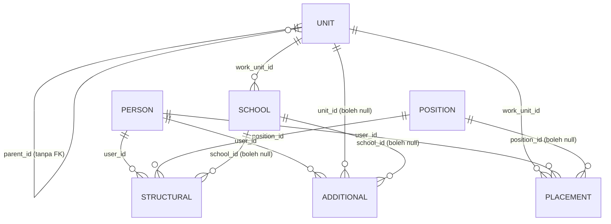

# 35c. Draf Kontrak API ALIM Core untuk ALIM Connect (Tahap 0)

> **Status: draf Tahap 0, 2026-11-22.** Dokumen dan artefak di sini **bukan kontrak final**. Bentuk
> yang tertulis adalah usulan Connect, disusun dari desain API milik ALIM Core dan dari pemetaan
> yang sudah disetujui; tidak satu pun endpoint telah dikonfirmasi tim Core, dan tidak ada endpoint
> yang tersedia di Core per tanggal ini.
>
> **Kedudukan dokumen.** [35a](./35a-alim-core-organization-mapping.md) adalah baseline arsitektur
> yang disetujui. [35b](./35b-alim-core-api-coordination-and-safety-plan.md) adalah paket koordinasi
> dan gerbang D9. Dokumen ini adalah **keluaran Tahap 0** yang diminta dari keduanya: kontrak draf,
> mock, fixture, uji kontrak, dan daftar hal yang masih menunggu Core.
>
> **Yang bukan dokumen ini.** Bukan persetujuan implementasi, bukan kontrak pengganti milik Core,
> bukan jadwal, dan bukan dasar untuk menyentuh sistem produksi. Bila dokumen ini berbeda dengan
> `docs/integration/alim-connect-api-design.md` milik Core, kontrak Core yang menang dan dokumen ini
> diperbarui.

---

## 1. Ringkasan

Tahap 0 menghasilkan lima hal:

| Artefak          | Lokasi                                             | Isi                                                                  |
| ---------------- | -------------------------------------------------- | -------------------------------------------------------------------- |
| Kontrak mesin    | `test/contracts/alim-core/connect-v1.openapi.yaml` | OpenAPI 3.1, 14 operasi `GET`, setiap operasi bertanda `provisional` |
| Mock server      | `test/contracts/alim-core/mock-server.ts`          | Server `node:http` tanpa dependensi, tanpa koneksi ke Core           |
| Fixture contoh   | `test/contracts/alim-core/fixtures/`               | 7 entitas, snapshot, changes, dan 3 berkas anomali                   |
| Uji kontrak      | `test/contracts/alim-core/contract.spec.ts`        | 50 uji: dokumen, fixture, paritas mock, kelengkapan dokumen ini      |
| Lane uji         | `test/contracts/jest.config.js`, `package.json`    | `npm run test:contracts` dan `npm run mock:alim-core`                |
| Daftar keputusan | dokumen ini §7–§8, §11–§12                         | K1–K10, Q1–Q10, S1–S8, dan keputusan pemilik sistem                  |

Cara menjalankan:

```bash
npm run test:contracts     # 50 uji, tanpa database dan tanpa jaringan ke Core
npm run mock:alim-core     # mencetak URL mock, mis. http://127.0.0.1:<port>/api/connect/v1
curl -H 'X-ALIM-CONNECT-KEY: test-connect-key' \
  http://127.0.0.1:<port>/api/connect/v1/organization/units
```

### 1.1 Cara membaca status

Setiap bagian memakai salah satu label berikut. **Konsisten tidak berarti disetujui**: ia hanya
berarti bentuk di draf, fixture, mock, dan desain Core saling cocok dan tidak ada pertentangan
internal.

| Label                   | Arti                                                                                    |
| ----------------------- | --------------------------------------------------------------------------------------- |
| `KONSISTEN`             | Draf, fixture, dan mock sepakat, dan bentuknya sesuai desain Core yang sudah dibaca     |
| `PROVISIONAL`           | Connect memilih bentuk ini; Core belum mengonfirmasi                                    |
| `BUTUH KONFIRMASI CORE` | Ada pertanyaan konkret (K/Q) yang harus dijawab Core sebelum bagian ini dapat dibekukan |
| `TERBUKA`               | Keputusan pemilik sistem, bukan keputusan teknis                                        |
| `BELUM`                 | Belum ada di Core atau belum dirancang; tidak boleh diasumsikan ada                     |

---

## 2. Batas Tahap 0

1. **Baca-saja.** Tidak ada `POST`, `PUT`, `PATCH`, atau `DELETE` di kontrak. Uji menolak kemunculan
   metode tulis, dan mock menjawab `405` untuk metode selain `GET`.
2. **Tanpa koneksi.** Mock tidak membuka koneksi ke Core, database, atau host lain. Tidak ada
   kredensial produksi, tidak ada URL produksi, dan tidak ada fallback ke data nyata.
3. **Tanpa master lokal.** Tidak ada tabel, migration, atau read model yang dibuat. Fixture hanyalah
   contoh bentuk, bukan salinan data.
4. **Tanpa perubahan RBAC.** `role_assignments`, `PermissionService`, jembatan `hasPermission`,
   `authzVersion`, invalidasi cache, dan fingerprint WebSocket tidak disentuh. `scopeType=unit` tetap
   ditolak `400`.
5. **Tanpa Tahap 1.** Tidak ada scheduler, endpoint Connect baru, atau tabel `core_*`.

---

## 3. Konvensi umum

| Konvensi          | Isi draf                                                                 | Status                  | Sumber                    |
| ----------------- | ------------------------------------------------------------------------ | ----------------------- | ------------------------- |
| Base path         | `/api/connect/v1`                                                        | `PROVISIONAL`           | Desain Core §3.1          |
| Metode            | Hanya `GET`                                                              | `KONSISTEN`             | 35b §2, prinsip baca-saja |
| Autentikasi       | Header `X-ALIM-CONNECT-KEY`, kunci terpisah dari POS/Recruitment         | `BUTUH KONFIRMASI CORE` | K9, D14                   |
| Alternatif auth   | `Authorization: Bearer` **tidak** dipakai mock                           | `PROVISIONAL`           | Desain Core §3.1          |
| Envelope          | `success`, `message`, `data`, `meta`, `errors`                           | `KONSISTEN`             | Desain Core §3.1          |
| `meta`            | `request_id`, `timestamp`, `server_time`, `pagination`/`next_cursor`     | `KONSISTEN`             | Desain Core §3.1, §3.10   |
| Pagination        | `page` ≥ 1, `per_page` 1–200 (default 50), `total`, `last_page`          | `PROVISIONAL`           | K3                        |
| Waktu             | ISO-8601 dengan zona aplikasi; `updated_since` inklusif                  | `BUTUH KONFIRMASI CORE` | K1                        |
| `snapshot_at`     | Batas atas `updated_at` yang disertakan                                  | `BUTUH KONFIRMASI CORE` | K1                        |
| `changes.since`   | Wajib; mock memakai perbandingan eksklusif (`>`), Core belum menetapkan  | `BUTUH KONFIRMASI CORE` | K4                        |
| Error             | `401`, `403`, `404`, `422`, `429`, `503`                                 | `KONSISTEN`             | Desain Core §3.1          |
| Header respons    | `X-ALIM-API-Version`, `X-Request-Id`, `Cache-Control: no-store, private` | `KONSISTEN`             | 35b §3.4, §6.2            |
| `include_deleted` | Hanya snapshot/changes; list biasa tidak memakainya                      | `PROVISIONAL`           | K5                        |
| Field pribadi     | Hanya field pada 35a §8.3; tidak ada `nik`, `no_kk`, alamat, `nomor_sk`  | `KONSISTEN`             | 35a §8.3                  |
| Versi             | `1` di path dan header; perubahan hanya aditif setelah beku              | `BUTUH KONFIRMASI CORE` | K2                        |

Catatan: `updated_since` dan `snapshot_at` sama-sama bergantung pada K1. Bila Core memakai zona
waktu berbeda atau `updated_since` eksklusif, sinkronisasi dapat melewatkan atau menggandakan baris;
karena itu keduanya tidak boleh dibekukan sebelum K1 dijawab.

---

## 4. Endpoint

| Prioritas | Endpoint                                    | Data                       | Status        | Catatan                                                             |
| --------- | ------------------------------------------- | -------------------------- | ------------- | ------------------------------------------------------------------- |
| P0        | `GET /organization/units`                   | Unit datar + hierarki      | `PROVISIONAL` | `tree=true` sengaja tidak dimasukkan; lihat §10                     |
| P0        | `GET /organization/units/{id}`              | Detail unit                | `PROVISIONAL` | Bentuk `include` default belum disepakati                           |
| P0        | `GET /organization/schools`                 | Satuan pendidikan          | `PROVISIONAL` | Tanpa `deleted_at`; penghapusan hanya lewat rekonsiliasi            |
| P0        | `GET /organization/schools/{id}`            | Detail sekolah             | `PROVISIONAL` | Sama                                                                |
| P0        | `GET /organization/positions`               | Katalog jabatan            | `PROVISIONAL` | `domain` boleh null; `hierarchy_level` bukan otoritas               |
| P0        | `GET /organization/positions/{id}`          | Detail jabatan             | `PROVISIONAL` | Sama                                                                |
| P0        | `GET /organization/people`                  | Orang/GTK                  | `PROVISIONAL` | `id` adalah UUID orang Core, bukan akun Connect                     |
| P0        | `GET /organization/people/{id}`             | Detail orang               | `PROVISIONAL` | `primary_unit` boleh null                                           |
| P1        | `GET /organization/people/{id}/assignments` | Tiga sumber penugasan      | `PROVISIONAL` | Bentuk seragam **belum ditetapkan**; hanya `source`/`id` dipaku     |
| P1        | `GET /organization/work-unit-assignments`   | Penempatan unit            | `PROVISIONAL` | Tanpa status, tanggal, atau tombstone                               |
| P1        | `GET /organization/structural-assignments`  | Penugasan struktural       | `PROVISIONAL` | Satu-satunya sumber dengan status + masa berlaku + soft delete      |
| P1        | `GET /organization/additional-tasks`        | Tugas tambahan dua sumber  | `PROVISIONAL` | Kunci komposit `(source, id)` wajib                                 |
| P1        | `GET /organization/snapshot`                | Bootstrap dan rekonsiliasi | `PROVISIONAL` | `ndjson` didokumentasikan tetapi tidak dimodelkan mock              |
| P2        | `GET /organization/changes`                 | Incremental + tombstone    | `BELUM`       | Menunggu change ledger Core; tidak dapat diimplementasikan hari ini |

Urutan prioritas mengikuti ketergantungan data, bukan abjad: unit → sekolah → jabatan → orang →
penempatan → assignment → tugas tambahan. Connect tidak dapat menautkan akun sebelum orang ada, dan
tidak dapat memakai assignment sebelum unit dan orang ada.

### 4.1 Bentuk pohon unit

Desain Core menyebut `tree=true` mengembalikan pohon dan mengabaikan pagination. Draf ini **tidak**
memasukkan parameter itu karena bentuk `children` belum ditetapkan dan tidak ada contoh respons.
Kontrak hanya memaku daftar datar dengan `parent_id`; Connect dapat menyusun pohonnya sendiri dari
daftar itu tanpa menunggu keputusan bentuk.

### 4.2 Penempatan tanpa siklus hidup

`gtk_work_unit` tidak memiliki `status`, `start_date`, `end_date`, atau `deleted_at`. Draf karena itu
tidak menawarkan field yang tidak ada: baris yang hilang berarti penempatan berakhir, dan `id` baris
dapat berubah bila baris dibuat ulang. Ini konsisten dengan temuan 35a §2.4 dan bukan pilihan desain
Connect.

### 4.3 Penugasan struktural

`work_unit_id` diturunkan dari `school.work_unit_id` dan tidak disimpan pada assignment. Draf
mempertahankan `is_effective` sebagai field yang dihitung server, dengan aturan yang sama seperti
desain Core: `status = active`, `start_date <= active_on`, `end_date` null atau ≥ `active_on`, dan
`deleted_at` null. Connect tidak menghitung ulang aturan itu; ia memakai nilai yang dikirim Core.

### 4.4 Tugas tambahan

Dua tabel, dua makna, satu bentuk. `source` membedakan asalnya, dan `(source, id)` adalah kunci
identitas. `gtk_additional_tasks` tidak memiliki `school_id` atau `academic_year_id`; draf
mengirimnya sebagai `null` dan **tidak** menebaknya dari decree.

### 4.5 Snapshot dan changes

Snapshot memuat `generated_at`, `snapshot_at`, `schema_version`, `counts`, `checksums`, dan array per
tipe. `checksums` adalah sha256 dari daftar `id` terurut per entitas; algoritme itu belum
diimplementasikan di Core dan karenanya `PROVISIONAL`.

`changes` adalah satu-satunya endpoint yang statusnya `BELUM`: Core belum memiliki change ledger, dan
sebagian entitas tidak memiliki soft delete. Draf tetap memaku amplop dan bentuk item supaya konsumen
di Connect dapat disiapkan, tetapi tidak menjanjikan endpoint tersedia. Mock menyajikannya dari
fixture statis, bukan dari ledger.

---

## 5. Skema dan relasi

### 5.1 Entitas yang dikonsumsi



| Relasi                         | Kardinalitas | Kunci                              | Status      |
| ------------------------------ | ------------ | ---------------------------------- | ----------- |
| Unit → unit (induk)            | banyak→satu  | `parent_id` (tanpa FK)             | `KONSISTEN` |
| Unit → sekolah                 | satu→banyak  | `schools.work_unit_id`             | `KONSISTEN` |
| Orang → penempatan             | satu→banyak  | `gtk_work_unit.user_id`            | `KONSISTEN` |
| Orang → penugasan struktural   | satu→banyak  | `structural_assignments.user_id`   | `KONSISTEN` |
| Orang → tugas tambahan         | satu→banyak  | `(source, user_id)`                | `KONSISTEN` |
| Sekolah → penugasan struktural | satu→banyak  | `structural_assignments.school_id` | `KONSISTEN` |
| Jabatan → penempatan/penugasan | satu→banyak  | `position_id`                      | `KONSISTEN` |

### 5.2 Aturan yang diuji

Uji kontrak menegakkan aturan berikut pada fixture:

1. Setiap `id` unik dalam satu entitas.
2. Setiap `parent_id` menunjuk unit yang ada, atau `null`.
3. Setiap `schools.work_unit_id` menunjuk unit yang ada.
4. Setiap `placement.user_id` menunjuk orang yang ada dan `work_unit_id` menunjuk unit yang ada.
5. Setiap `structural.user_id`, `position_id`, `school_id`, dan `work_unit_id` menunjuk baris yang ada.
6. Setiap `additional.user_id`, `unit_id`, dan `school_id` menunjuk baris yang ada.
7. Snapshot identik dengan daftar per entitas, dan `counts` sama dengan panjang array.
8. Tidak ada baris dengan `updated_at` melewati `snapshot_at`.
9. Setiap `change` bertipe `upsert` membawa payload yang sah dan `id` yang dikenal; `delete` membawa
   `payload: null` dan `deleted_at` tidak null.
10. Tidak ada field pribadi di luar matriks 35a §8.3.

Anomali yang **memang ada** di Core tidak disembunyikan: `fixtures/edge/` memuat unit dengan induk
yatim, dua unit yang saling menjadi induk, dan penugasan yang sudah dihapus. Ketiganya divalidasi
terhadap skema, tetapi sengaja tidak lolos pemeriksaan relasi. Ini memastikan kontrak tidak
mengklaim data Core bersih.

### 5.3 Field yang dipakai Connect

| Entitas               | Field minimum                                                                                                                                | Status      |
| --------------------- | -------------------------------------------------------------------------------------------------------------------------------------------- | ----------- |
| Unit                  | `id`, `code`, `name`, `type`, `parent_id`, `divisi`, `domain`, `is_active`, `updated_at`                                                     | `KONSISTEN` |
| Sekolah               | `id`, `work_unit_id`, `npsn`, `name`, `school_level`, `school_gender`, `is_active`, `updated_at`                                             | `KONSISTEN` |
| Jabatan               | `id`, `code`, `name`, `jenis_gtk`, `domain`, `level`, `is_active`, `updated_at`                                                              | `KONSISTEN` |
| Orang                 | `id`, `name`, `username`, `email`, `is_active`, `status_kepegawaian`, `primary_unit`, `updated_at`                                           | `KONSISTEN` |
| Penempatan            | `id`, `user_id`, `work_unit_id`, `position_id`, `is_primary`, `updated_at`                                                                   | `KONSISTEN` |
| Assignment struktural | `id`, `user_id`, `position_id`, `school_id`, `academic_year_id`, `decree_id`, `start_date`, `end_date`, `status`, `deleted_at`, `updated_at` | `KONSISTEN` |
| Tugas tambahan        | `source`, `id`, `user_id`, `unit_id`, `school_id`, `academic_year_id`, `task_name`, `task_code`, `is_active`, `updated_at`                   | `KONSISTEN` |

Tidak disinkronkan: `nik`, `no_kk`, alamat, data keluarga, dan `nomor_sk`. Uji menolak kemunculan
kunci-kunci itu di seluruh fixture.

---

## 6. Alur sinkronisasi terhadap mock

```mermaid
sequenceDiagram
  participant S as Scheduler Connect
  participant M as Mock ALIM Core
  participant R as Read model (Tahap 1, belum ada)
  S->>M: GET /organization/snapshot?types=units,schools,...
  M-->>S: data + snapshot_at + counts
  Note over S: Tahap 0 hanya memvalidasi bentuk;<br/>tidak menulis apa pun
  S->>M: GET /organization/changes?since=snapshot_at
  M-->>S: 3 perubahan contoh (2 upsert, 1 delete)
  S->>M: GET /organization/units?updated_since=<cursor>
  M-->>S: halaman dengan meta.pagination
```

Tahap 0 berhenti sebelum baris `Note` kedua: tidak ada penulisan, cursor, atau rekonsiliasi. Diagram
ini hanya menunjukkan bahwa urutan panggilan yang diminta 35a §8.5 dapat dilayani bentuk kontraknya.

---

## 7. K1–K10: keputusan kontrak

Sepuluh hal ini harus dijawab Core sebelum kontrak dapat dibekukan. Kolom "asumsi draf" adalah yang
**dipakai mock sekarang**, bukan keputusan.

| No  | Hal                  | Asumsi draf                                                                      | Yang harus dikonfirmasi Core                                                     | Status                  |
| --- | -------------------- | -------------------------------------------------------------------------------- | -------------------------------------------------------------------------------- | ----------------------- |
| K1  | Semantik waktu       | `updated_since` inklusif; `snapshot_at` batas atas; zona aplikasi                | Zona waktu yang dikirim, inklusif/eksklusif, dan perilaku saat `updated_at` null | `BUTUH KONFIRMASI CORE` |
| K2  | Versi kontrak        | `1` di path dan header; perubahan aditif saja                                    | Aturan kompatibilitas dan cara mengumumkan perubahan yang memutus                | `BUTUH KONFIRMASI CORE` |
| K3  | Pagination           | `page`/`per_page` 1–200; `last_page` 0 bila kosong                               | Apakah `changes` memakai cursor dan bagaimana bentuk `next_cursor`               | `BUTUH KONFIRMASI CORE` |
| K4  | Urutan `changes`     | `(updated_at, id)` dan perbandingan `since` eksklusif                            | Urutan deterministik resmi dan arti `since`                                      | `BUTUH KONFIRMASI CORE` |
| K5  | Arti delete          | `delete` + `deleted_at`; baris hilang = berakhir                                 | Apakah setiap entitas punya tombstone, dan apa arti `status` vs `deleted_at`     | `BUTUH KONFIRMASI CORE` |
| K6  | Idempotensi          | Pengiriman ulang tidak mengubah hasil                                            | Jaminan at-least-once dan batas waktu replay                                     | `BUTUH KONFIRMASI CORE` |
| K7  | Penanganan `null`    | `parent_id`, `divisi`, `domain`, `school_id`, `decree_id`, `end_date` boleh null | Daftar field nullable yang resmi, termasuk `npsn` dan `status_kepegawaian`       | `BUTUH KONFIRMASI CORE` |
| K8  | Kunci tugas tambahan | `(source, id)` unik dan stabil                                                   | Apakah `id` stabil antar-rilis dan apakah `(source,id)` dijamin unik             | `BUTUH KONFIRMASI CORE` |
| K9  | Autentikasi          | `X-ALIM-CONNECT-KEY`, kunci terpisah, allowlist IP                               | Nama header final, dukungan `Bearer`, dan apakah allowlist wajib                 | `BUTUH KONFIRMASI CORE` |
| K10 | Rate limit           | List 120/menit, snapshot 6/menit, changes 60/menit                               | Angka final setelah Q9 dan bentuk `Retry-After`                                  | `BUTUH KONFIRMASI CORE` |

---

## 8. Q1–Q10: kualitas data

Pemeriksaan ini milik Core dan **belum dijalankan**. Connect tidak dapat menjalankannya tanpa akses
data, dan tidak boleh menganggap hasilnya bersih. Yang tercantum adalah perilaku Connect bila temuan
muncul.

| No  | Pemeriksaan                                         | Pemilik | Status  | Perilaku Connect bila temuan                                     |
| --- | --------------------------------------------------- | ------- | ------- | ---------------------------------------------------------------- |
| Q1  | `work_units.parent_id` menunjuk unit yang tidak ada | Core    | `BELUM` | Tampilkan unit sebagai akar sementara; jangan menebak induk      |
| Q2  | Siklus pada `parent_id`                             | Core    | `BELUM` | Deteksi saat membangun pohon; tandai siklus, jangan rekursi      |
| Q3  | `structural_positions.domain_id` null               | Core    | `BELUM` | Tampilkan "tanpa domain"; jangan menurunkan domain dari nama     |
| Q4  | Lebih dari satu `is_primary` per orang              | Core    | `BELUM` | Pilih deterministik; laporkan; jangan ubah data Core             |
| Q5  | `schools.work_unit_id` menunjuk unit yang tidak ada | Core    | `BELUM` | Tandai `unresolved`; sekolah tetap disimpan, tidak dipakai scope |
| Q6  | `structural_assignments.school_id` hilang           | Core    | `BELUM` | Tandai `unresolved`; assignment tidak memberi akses              |
| Q7  | `users` tanpa `gtk_profile`/`gtk_employment`        | Core    | `BELUM` | Tampilkan tanpa status kepegawaian; tetap dapat ditautkan        |
| Q8  | Duplikasi natural key (email, npsn, code)           | Core    | `BELUM` | Jangan menautkan otomatis; minta verifikasi manual               |
| Q9  | Jumlah baris per entitas                            | Core    | `BELUM` | Menjadi dasar anggaran beban dan ukuran halaman                  |
| Q10 | `updated_at` null atau tidak bergerak pada update   | Core    | `BELUM` | Snapshot tidak dapat diandalkan; naikkan rekonsiliasi harian     |

Q1, Q2, Q5, Q6, Q8, dan Q10 bersifat **blocking** untuk canary L2 (35b §6.4). Sisanya harus diukur
dan diputuskan.

---

## 9. Bagian yang sudah konsisten

Yang dimaksud "konsisten" di sini: draf, fixture, mock, dan desain Core yang sudah dibaca saling
cocok, dan uji kontrak menegakkannya. Ini **bukan** pengakuan bahwa Core setuju.

1. **Envelope dan error.** `success`/`message`/`data`/`meta`/`errors` dan himpunan status
   `401/403/404/422/429/503` sama dengan desain Core §3.1. Mock mengirim amplop yang sama untuk
   respons sukses dan gagal, dan uji memvalidasi keduanya.
2. **Nama field entitas.** Seluruh field memakai `snake_case` dan diambil dari contoh respons desain
   Core §3.2–3.8, yang bersumber dari migration `work_units`, `schools`, `structural_positions`,
   `gtk_work_unit`, `structural_assignments`, `gtk_additional_tasks`, dan `other_teacher_tasks`.
3. **Relasi inti.** `schools.work_unit_id`, `structural_assignments.work_unit_id` turunan dari
   sekolah, dan `gtk_work_unit` tanpa siklus hidup semuanya sesuai temuan 35a §2.4 dan §3.
4. **Kunci komposit tugas tambahan.** `(source, id)` dipakai konsisten di skema, fixture, dan mock;
   uji memastikan tidak ada id tunggal yang dipakai dua kali.
5. **Baca-saja.** Tidak ada metode tulis di dokumen; mock menjawab `405`; uji menolak kemunculan
   `post:`/`put:`/`patch:`/`delete:` pada level operasi.
6. **Field pribadi.** Tidak ada `nik`, `no_kk`, alamat, atau `nomor_sk` di seluruh fixture, sesuai
   35a §8.3.
7. **Snapshot dan daftar.** Snapshot memakai baris yang sama dengan daftar per entitas; uji
   membandingkan keduanya secara penuh dan memeriksa `counts`.
8. **Anomali tidak disembunyikan.** `fixtures/edge/` memuat induk yatim, siklus, dan baris terhapus;
   ketiganya sah secara skema dan gagal secara relasi, persis seperti data Core.
9. **Status `unit`.** Tidak ada perubahan pada RBAC Fase 1a dan tidak ada `scopeType=unit` di kontrak;
   perilaku `400` tetap berlaku.
10. **Header keamanan.** Setiap respons mock membawa `X-ALIM-API-Version`, `X-Request-Id`, dan
    `Cache-Control: no-store, private`, sesuai 35b §3.4 dan §6.2.

---

## 10. Bagian yang masih provisional

| Bagian                                        | Mengapa provisional                                                         | Dikonfirmasi oleh  | Dampak bila berubah                                     |
| --------------------------------------------- | --------------------------------------------------------------------------- | ------------------ | ------------------------------------------------------- |
| Ketersediaan seluruh endpoint                 | Tidak ada rute `/api/connect/v1` di Core                                    | Tim Core (D9)      | Seluruh Tahap 1 tertunda                                |
| `updated_since` dan `snapshot_at`             | K1 belum dijawab                                                            | Tim Core           | Sinkronisasi dapat melewatkan atau menggandakan baris   |
| `changes`                                     | Belum ada change ledger; sebagian entitas tanpa soft delete                 | Tim Core           | Tahap 5 tidak dapat dimulai                             |
| Bentuk `people/{id}/assignments`              | Bentuk seragam tiga sumber belum dirancang; draf hanya memaku `source`+`id` | Tim Core           | Konsumen harus menunggu; jangan dipakai untuk scope     |
| `tree=true` pada unit                         | Bentuk `children` belum ada contoh                                          | Tim Core           | Connect menyusun pohon sendiri dari daftar datar        |
| `boarding_type` dan `school_level_text`       | Nilai aktual belum diverifikasi                                             | Tim Core           | Hanya tampilan; tidak memengaruhi scope                 |
| `npsn` wajib string                           | Audit belum memastikan `npsn` tidak pernah null                             | Tim Core           | Skema longgar bila nullable                             |
| `status` assignment (`active/inactive/ended`) | Enum belum diverifikasi terhadap data                                       | Tim Core           | Filter status dapat berbeda                             |
| `checksums` snapshot                          | Algoritme belum diimplementasikan                                           | Tim Core           | Rekonsiliasi memakai perbandingan id                    |
| `format=ndjson`                               | Tidak dimodelkan mock                                                       | Tim Core           | Snapshot besar harus dipaginasi                         |
| Angka rate limit                              | Menunggu Q9                                                                 | Tim Core + pemilik | Mock memakai angka contoh, bukan angka produksi         |
| `Authorization: Bearer`                       | Desain menyebut alternatif; mock tidak memakainya                           | Tim Core (K9)      | Klien harus memakai header kunci                        |
| `last_page = 0` untuk himpunan kosong         | Pilihan draf, bukan aturan Core                                             | Tim Core (K3)      | Klien yang membagi `total/last_page` harus menyesuaikan |
| `since` eksklusif pada `changes`              | Core belum menetapkan; mock memilih `>`                                     | Tim Core (K4)      | Risiko baris terlewat atau dobel                        |

---

## 11. Keputusan yang membutuhkan persetujuan pemilik sistem

Tahap 0 tidak mengubah keputusan yang sudah ditetapkan (D2, D5, D9 sebagian, D12). Yang berikut masih
terbuka dan **tidak boleh** diperlakukan sebagai persetujuan teknis.

| No       | Keputusan                                                    | Mengapa menghambat                                           | Rekomendasi                        |
| -------- | ------------------------------------------------------------ | ------------------------------------------------------------ | ---------------------------------- |
| D1       | Grant `unit` mencakup subtree atau tidak                     | Menentukan arti scope saat Tahap 4, bukan Tahap 0            | Unit saja untuk fase pertama       |
| D3       | Kebijakan penautan orang Core ↔ akun Connect                 | Menentukan apakah `email` boleh jadi petunjuk                | Manual dengan saran otomatis       |
| D4       | Perilaku saat orang Core nonaktif/berhenti                   | Menentukan apakah akun Connect ikut dinonaktifkan            | Tandai, jangan matikan otomatis    |
| D6       | Apakah sekolah menjadi dimensi scope sendiri                 | Menentukan `scopeType` baru di masa depan                    | Tidak; turunan unit                |
| D7       | Field orang minimum yang boleh disalin                       | Menyangkut privasi; menentukan isi kontrak `people`          | Nama + status + email/username     |
| D8       | Frekuensi sinkronisasi dan staleness yang diterima           | Menentukan jadwal dan anggaran beban                         | Master 1 jam; assignment 15 menit  |
| D10      | Menunggu `changes` atau snapshot + polling lebih dulu        | Menentukan apakah Tahap 1 boleh jalan tanpa ledger           | Snapshot + polling lebih dulu      |
| D11      | Penanganan banyak baris `gtk_employments` per orang          | Menentukan nilai `status_kepegawaian` yang dikirim           | Baris terbaru; semua di detail     |
| D13      | Grant yang menunjuk unit hilang: dibiarkan atau dihapus      | Menentukan perilaku `unresolved`                             | Dibiarkan, fail-closed             |
| D14      | Apakah Connect boleh memakai kunci POS/Recruitment sementara | Menentukan kunci yang dipakai mock dan staging               | Tidak; kunci terpisah              |
| S1       | PIC Core dan Connect                                         | Tanpa PIC, K1–K10 tidak dapat ditandatangani                 | Ditetapkan bersama jadwal D9       |
| S2       | Ruang lingkup rilis pertama (P0 saja atau P0+P1)             | Menentukan urutan canary                                     | P0 saja                            |
| S4       | Penyimpanan kunci Connect                                    | Menentukan prosedur rotasi                                   | `system_settings`, rotasi tercatat |
| S6       | Angka rate limit final                                       | Menentukan konfigurasi limiter                               | Setelah Q9                         |
| **Baru** | **Otorisasi pembekuan kontrak**                              | Menentukan siapa yang menandatangani K1–K10 dan kapan        | Pemilik sistem + pemilik API Core  |
| **Baru** | **Apakah mock boleh dipakai sebagai basis uji Tahap 1**      | Menentukan apakah Tahap 1 dapat dimulai sebelum endpoint ada | Ya, sebagai kontrak eksekutabel    |

---

## 12. S1–S8: kebutuhan koordinasi

| No  | Kebutuhan                                 | Pemilik keputusan      | Status    | Yang dibutuhkan                                  |
| --- | ----------------------------------------- | ---------------------- | --------- | ------------------------------------------------ |
| S1  | PIC Core dan Connect                      | Pemilik sistem         | `TERBUKA` | Nama peran, bukan nama orang                     |
| S2  | Ruang lingkup rilis pertama               | Pemilik sistem         | `TERBUKA` | P0 saja atau P0+P1                               |
| S3  | Jadwal dan jendela snapshot               | Operasi Core           | `TERBUKA` | Jam di luar sibuk, disepakati tertulis           |
| S4  | Penyimpanan kunci Connect                 | Core                   | `TERBUKA` | `system_settings` atau env, plus prosedur rotasi |
| S5  | Koneksi baca khusus untuk integrasi       | Core                   | `TERBUKA` | Koneksi utama atau read replica                  |
| S6  | Angka rate limit                          | Core + pemilik         | `TERBUKA` | Angka per menit setelah Q9                       |
| S7  | Pemilik perbaikan data Q1/Q2/Q5/Q6/Q8/Q10 | Core                   | `TERBUKA` | Penanggung jawab dan tenggat sebelum L2          |
| S8  | Kanal dan jadwal komunikasi insiden       | Operasi Core + Connect | `TERBUKA` | Kanal yang ada atau kanal khusus integrasi       |

S1–S8 tidak dapat diselesaikan oleh dokumen. Tahap 0 hanya menyiapkan bahan agar rapat koordinasi
memiliki daftar yang konkret.

---

## 13. Verifikasi

| Pemeriksaan                                     | Hasil                                                        |
| ----------------------------------------------- | ------------------------------------------------------------ |
| `npm run test:contracts`                        | 50 uji lulus (dokumen 7, fixture 16, mock 23, kelengkapan 4) |
| Paritas path OpenAPI ↔ mock                     | 14 path, himpunan sama                                       |
| Operasi tulis di dokumen                        | 0                                                            |
| `$ref` yang tidak terselesaikan                 | 0                                                            |
| Fixture yang gagal skema                        | 0                                                            |
| Relasi yang menunjuk baris hilang (data normal) | 0                                                            |
| Field pribadi terlarang                         | 0                                                            |
| Respons mock yang gagal skema operasinya        | 0                                                            |
| `npm run test:docs`                             | Lane dokumen tetap lulus setelah dokumen ini ditambahkan     |
| `npx tsc --noEmit`                              | Hanya 6 galat lama yang tidak terkait (lihat 35b §13)        |

---

## 14. Batas yang tidak dilanggar

- Tidak ada perubahan pada ALIM Core: tidak ada rute, migration, model, atau konfigurasi.
- Tidak ada koneksi ke API produksi Core; mock hanya membaca fixture lokal.
- Tidak ada tabel atau master organisasi lokal di Connect.
- Tidak ada perubahan pada RBAC Fase 1a, `role_assignments`, atau guard.
- `scopeType=unit` tetap ditolak `400`; tidak ada aktivasi scope.
- Tidak ada Tahap 1, Fase 1b, atau Fase 1c.
- Tidak ada klaim bahwa kontrak ini final atau bahwa Core telah menyetujuinya.
